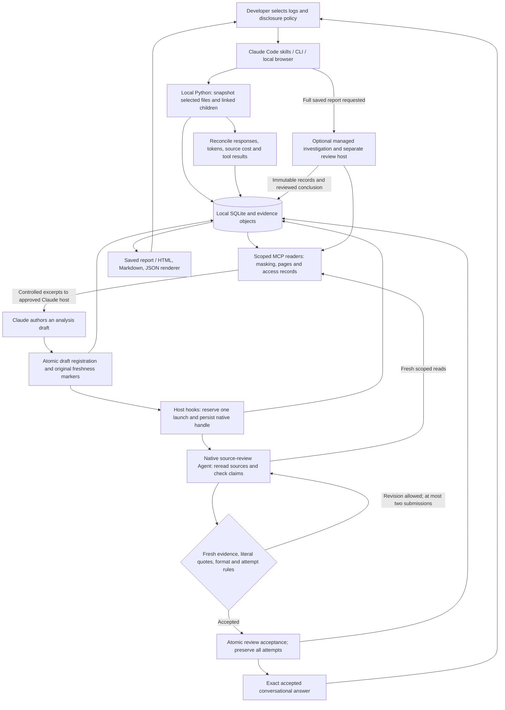

# System architecture

The deterministic Python engine and the model-written investigation are separate
parts of the system. Python imports selected evidence, computes usage and guards
persistence. The approved Claude Code host authors all task judgments and
recommendations. Renderers do not manufacture findings or rewrite that wording.

The conversational path uses a native child Agent inside the approved host.
The managed saved-report path uses separate host processes. Neither path permits
executing archived commands or applying recommendations during analysis.

[Standalone Mermaid source](architecture.mmd) is included for rendering or editing.

## Source map

| Area | Main files | Responsibility |
| --- | --- | --- |
| Plugin entry | `.claude-plugin/plugin.json`, `.claude-plugin/marketplace.json`, `.mcp.json`, `skills/`, `agents/` | Installation, command routing, prompts and native reviewer configuration. |
| CLI and MCP | `scripts/ally-session.py`, `ally_analyzer/cli.py`, `mcp.py`, `service.py` | Local entrypoints, JSON-RPC transport, registered tools and scope/disclosure enforcement. |
| Ingest and accounting | `ingest.py`, `normalize.py`, `engine.py`, `session_metrics.py` | Snapshot source, reconcile streaming identities and calculate deterministic facts. |
| Pricing | `pricing.py`, `session_cost.py`, `verified_prices.json` | Dated rates, explicit overrides, inclusive token categories and unknown-price limits. |
| Scope and evidence | `session_scope.py`, `session_investigation.py`, `store.py` | Selected roots/linked children, source readers, access logs and persisted records. |
| Conversational reviews | `session_reply_review.py`, `session_collection.py`, `reply_review.py`, `session_readout.py` | Single/collection drafts, request coverage, exact quote checks, output contract and atomic registration/admission. |
| Full reports | `claude_runner.py`, `session_review.py`, `session_validation.py`, `session_report.py` | Managed investigation/review, append-only revisions, readiness checks and unchanged authored exports. |
| Browser | `session_library.py`, `session_library.html`, `session_report.js` | Explicit directory browsing, saved results, source inspection and approved updates. |
| Verification | `tests/`, `scripts/check_install.py`, `scripts/test_claude_release.py` | Offline regression, model-free MCP installation check and opt-in live host tracing. |

Unless prefixed otherwise, Python files in the table are under `ally_analyzer/`.

## Persistence and trust boundaries

Draft registration uses a short SQLite `BEGIN IMMEDIATE` transaction to recheck
owner/kind/key, capture freshness markers and append the winning draft. Retries
reuse its ID and original markers. Review admission separately serializes the
history check and append, enforcing one accepted answer and at most two distinct
submissions. Validation that opens other connections runs outside those writer
transactions. Historical duplicates, rejected attempts and exact authored text
remain accessible; history is not deleted to make a check pass.

The store's evidence-access records show what text was delivered, not whether a
model understood it. Quote checks prove literal occurrence and linkage, not
entailment. Native child/paid-request provenance must be checked in host traces.
An accepted review does not establish task success or universal correctness.

The Python engine has no model client or network dependency. Source excerpts
cross into the approved Claude host only under the operator's disclosure policy;
the host/provider may use network access. Source logs are untrusted evidence.
The bundled renderer uses saved fields, not an extra prose-editing model.

## Current limitations

The [0.22.2 live audit](release-live-audit-0.22.2.md) records the failures that
motivated 0.23.1. The current candidate requires captured skill/retained-context
reads and an instruction-context source check, rejects the observed topic leak,
and uses plugin `PreToolUse`/`SubagentStart` hooks to reserve one launch and save
its native ID. SQLite reservations have no automatic expiry that buys a replacement.
The parent must resume the saved ID in the original host session. If that host
refuses resume, review stays incomplete. The normal handoff diagram and offline
checks do not certify semantic accuracy or actual paid invocation counts; those
require the current live traces.

For the earlier full-investigation design, see [system overview](system-overview.md)
and [the original Mermaid source](session-analyzer-system.mmd). For current
maintenance and checks, see [development](development.md).
