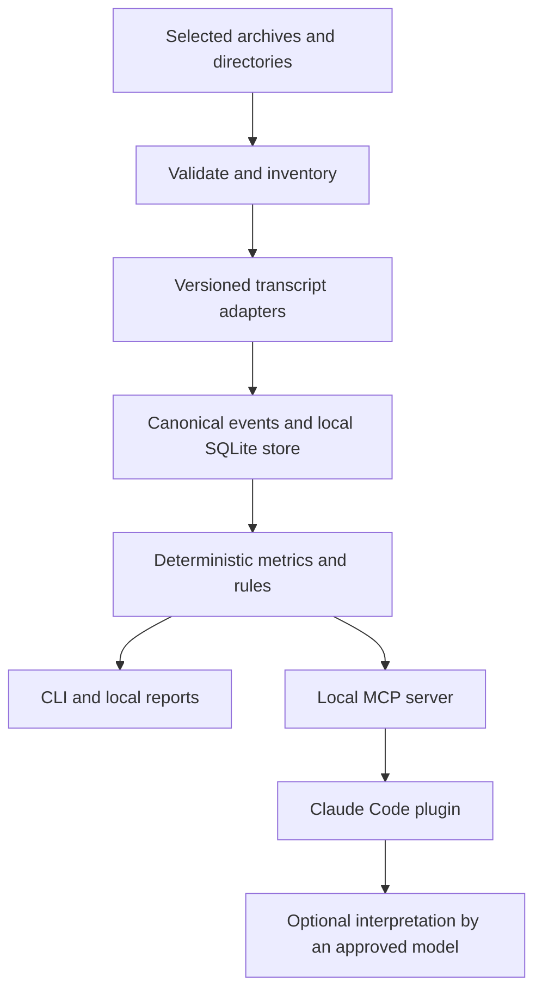

# Ally Claude Session Analyzer Draft Specification

Draft 0.1 · October 13, 2026

Scope update October 14, 2026: the [single session investigation specification](single-session-investigation-spec.md) governs the next investigation iteration. Its single-session scope supersedes batch-first investigation requirements here. This document remains the broader accounting and import design; cross-session investigation is deferred.

The analyzer will process batches of Claude Code session archives on an analyst's workstation. A deterministic engine will reconstruct recorded activity, calculate metrics, and apply explicit detection rules. A Claude Code plugin will expose that engine to agents. Analysts must also be able to run every core operation without an agent or an LLM connection.

The primary questions are where time and tokens went, how tools and agents behaved, whether repeated work produced progress, and which delivery outcomes have supporting evidence. Agent explanations are optional annotations over computed results. They cannot create or replace the underlying accounting.

This remains the broader design specification. A runnable 0.1.0 engine and plugin are now implemented; see [implementation status](implementation-status.md) for delivered behavior, conservative rule boundaries, and pending requirements. A real Ally 2.1.190 session has been supplied and added to format validation. Pipeline-contract validation still needs deployed agentset configuration and appropriate stage evidence. Proposed defaults remain open to Ally review.

## 1 Confirmed requirements and scope

| ID | Requirement | Status |
| --- | --- | --- |
| C01 | Analyze batches of uploaded or locally selected archives first. | Confirmed |
| C02 | Run locally on an analyst's workstation. | Confirmed |
| C03 | Handle hundreds of developer sessions per analysis batch. | Confirmed; byte and event limits remain to be agreed |
| C04 | Deliver a plugin, with Claude Code as the primary agent integration. | Confirmed |
| C05 | Use deterministic software for transcript parsing, tool accounting, observable API activity, and token metrics. | Confirmed |
| C06 | Allow an optional Ally-approved LLM for interpretation; the core must work without it. | Confirmed |
| C07 | Use the supplied general Claude Code archive to develop the format adapter. Validate Ally-specific behavior later. | Confirmed |

The proposed first release includes a local engine, CLI, SQLite database, Claude Code plugin with local MCP tools, and a browser-readable report. Continuous collection, centrally hosted dashboards, automatic remediation, employee rankings, and direct Jira or GitLab writes are outside the first release.

The report should support a batch overview, session filtering, a timeline with agent lanes, a findings list, and evidence inspection. A local interactive viewer is useful, but its scope can be reduced to generated HTML plus JSON and CSV exports without changing the engine or plugin contracts.

## 2 Product architecture



The engine is a library shared by the CLI and MCP server. Neither interface implements a separate counting method. The MCP server uses local stdio transport; a network service is unnecessary for batch analysis. Long imports return job identifiers and bounded progress responses instead of streaming the entire corpus through model context.

SQLite is the proposed workstation store. Runtime and packaging choices remain dependent on Ally's approved operating systems and installation policy. Python is a reasonable engine option; the public contracts should not depend on that choice. Dependencies and parser versions must be pinned, and core analysis must not require network downloads at runtime.

### Claude Code plugin package

The proposed plugin identifier is `ally-session-analyzer`. Its package contains:

```text
ally-session-analyzer/
  .claude-plugin/plugin.json
  .mcp.json
  skills/analyze/SKILL.md
  skills/explain/SKILL.md
  bin/                         packaged engine entry points
  schemas/                     input and output contracts
  profiles/                    metric and rule configurations
```

Claude Code supports plugin manifests, namespaced skills, and plugin-provided MCP servers. The manifest and server configuration must be validated against the versions Ally supports. [Claude Code plugin manifest reference](https://code.claude.com/docs/en/plugins-reference)

The proposed `/ally-session-analyzer:analyze` skill helps an analyst select an archive and request an existing analysis profile. `/ally-session-analyzer:explain` retrieves computed findings and relevant evidence for discussion. These are proposed command names, not installed commands.

A skill is an agent-facing instruction, not the deterministic implementation. It must call the engine's tools rather than ask the model to read every transcript and invent aggregate counts. Installation alone must not scan a developer's machine, enable collection hooks, or analyze the current session. Data lives outside the plugin installation/cache directory so plugin upgrades cannot erase the analysis store.

The local MCP contract also permits future integration with other compatible agent clients. Supporting a second client's plugin packaging is a separate deliverable.

## 3 Determinism and evidence contract

For identical canonical input content, engine and adapter versions, metric definitions, rule configuration, price book, redaction policy, and time-zone settings, the engine must produce identical canonical analysis JSON and content identifiers.

Archive member ordering, worker scheduling, host locale, and ingestion time must not change metrics or findings. Operational metadata such as job start time and execution duration is stored separately from the canonical result. Repacking a ZIP with different compression or ZIP timestamps must not change the logical analysis if member paths and contents are unchanged. Archive byte hashes are retained separately for provenance.

Every output is assigned one of four evidence classes:

| Class | Meaning | Example |
| --- | --- | --- |
| Recorded | A field or event present in the source. | A tool result carries `is_error: true`. |
| Calculated | A reproducible computation over recorded evidence. | Sum of reconciled output-token values. |
| Rule finding | A deterministic condition matched; interpretation may still be uncertain. | The same command and error signature occurred three times. |
| Model interpretation | A separately stored, potentially nondeterministic explanation. | A suggestion that the task brief was ambiguous. |

Determinism does not establish correctness or completeness. A consistently wrong parser is still wrong, and a consistently matched repetition rule does not prove wasted work.

Each metric result includes its name and definition version, value and unit, scope, evidence references or a resolvable evidence-set identifier, coverage, exclusions, and warnings. Values may be null. Known sums must carry the number of eligible records, records with usable data, records with missing data, and unresolved conflicts. Coverage describes the imported evidence; 100% field coverage does not prove that the archive contains all activity.

Each finding includes a stable identifier, rule identifier and version, configured thresholds, matched event references, observed pattern, relevant missing evidence, and severity. Findings are reviewable and can be accepted or dismissed by an analyst without changing source events. Analyst decisions are separate annotations.

## 4 Ingestion and trace reconstruction

### Supported first release inputs

- ZIP archives preserving Claude Code project directories, main JSONL files, subagent JSONL and metadata, and referenced tool-output files.
- Selected local directories or individual JSONL files, with explicit warnings when related files are absent.
- A batch manifest assigning a source namespace, developer pseudonym if supplied, project labels, and optional work-item identifiers. Identity must not be guessed from a filesystem username.

Future adapters may accept exported OpenTelemetry events, pipeline audit events, CI results, and GitLab or Jira exports. These are additional evidence sources, not prerequisites for basic transcript analysis.

### Required importer behavior

| ID | Requirement |
| --- | --- |
| I01 | Inventory files and content hashes before analysis. Preserve source bytes and member path plus line or byte-offset provenance. |
| I02 | Stream records with bounded memory. Process sessions independently where possible; one damaged session must not discard the entire batch. |
| I03 | Record malformed lines and continue at the next valid JSONL boundary. Do not silently repair source bytes. Mark affected coverage. |
| I04 | Preserve unknown record types and unknown fields. Unsupported semantic fields remain unavailable until an adapter supports them. |
| I05 | Select adapters by observed version and schema features, including when a resumed session spans versions. A compatible-looking version is not automatically certified. |
| I06 | Make repeated imports idempotent. Exact reimports add provenance, not duplicate billable activity. |
| I07 | Detect conflicting records sharing an identity. Do not choose whichever upload arrived last. |
| I08 | Recognize relocated sessions, resumes, parent links, subagents, background tasks, compaction, and synthetic messages where the source permits. |
| I09 | Keep attempted tool calls distinct from completed or proven executed calls. A missing result is unresolved, not automatically a failure. |
| I10 | Freeze the imported evidence set for an analysis. Files still being appended need a captured snapshot and an incomplete-source marker. |
| I11 | Commit imports and analyses transactionally. An interrupted job must leave completed data queryable and incomplete work identifiable and safe to resume or rerun. |

ZIP processing must enforce configured limits on compressed size, expanded size, file count, per-record size, and nesting. Reject path traversal, absolute extraction paths, and unsafe link entries. Do not execute archived commands, scripts, plugins, or instructions. Render transcript text as inert content in HTML reports.

Claude Code documents the transcript format as internal and subject to version changes. Adapter fixtures and explicit compatibility reporting are therefore release requirements. [Claude Code monitoring and transcript correlation](https://code.claude.com/docs/en/monitoring-usage#event-correlation-attributes)

### Canonical entities

| Entity | Required relationship and meaning |
| --- | --- |
| Dataset and source file | Immutable imported evidence set, logical content digest, source namespace, provenance. |
| Session | Original session identity within a source namespace; may span files and directories. File count is not session count. |
| Agent run | Main agent or subagent, parent invocation when known, role, model, and lifecycle evidence. |
| Turn | A submitted prompt and its subsequent activity where correlation is possible. Record whether its origin is human, scheduled, system, subagent, or unknown. |
| Model response | Provider message identity, request identity when available, content blocks, model, usage, and completion status. |
| API attempt | Transport attempt with request/client identifiers and attempt information, only when telemetry establishes it. |
| Tool invocation | Unique tool-use identity, arguments, result references, outcome evidence, timestamps, and optional explicit duration. |
| Context event | Recorded attachments, skill attribution, instructions, output truncation, context sizes, and compaction. |
| Artifact event | Observed edits, patches, output references, hashes, and verification evidence. This is not automatically a complete repository snapshot. |
| Pipeline attempt | Work item, repository, stage, attempt, context/artifact version, and gate events when explicitly linked. |

Use documented or observed source IDs to establish relationships, with version-specific rules. A typical native grouping uses session and agent identity plus `message.id`, retaining `requestId`, event `uuid`, `parentUuid`, `promptId`, `apiBlockIndex`, and tool-use IDs. Synthetic assistant messages are tagged separately and excluded from provider-response counts.

Identical tool arguments with different invocation IDs are separate calls. Repeated assistant content blocks sharing a model response identity are parts of one response, not duplicate tool activity. Deduplication must never remove legitimate repeated actions just because their text matches.

Reconstruct conversation ancestry before presenting a replay. Keep abandoned branches and their observed spend; distinguish them from the selected conversation path. Order concurrent activity without pretending that overlapping tools ran serially.

Forked transcripts may include copied history. Where stable identities and provenance establish that an event is inherited, retain one original execution identity and a reference from the child conversation. Appearing in a second conversation history is not a new billable response or tool invocation. When inherited history cannot be distinguished reliably from new execution, flag the ambiguity rather than silently treating both copies as new spend.

## 5 Metric definitions

### Token accounting

For each eligible model response, preserve these separately:

| Field | Meaning and handling |
| --- | --- |
| `input_tokens` | Input neither read from cache nor used to create a cache entry. |
| `cache_creation_input_tokens` | Input used for cache creation. Preserve reported 5-minute and 1-hour breakdowns when available. |
| `cache_read_input_tokens` | Input read from the prompt cache. |
| `output_tokens` | Inclusive reported output count. |
| `output_tokens_details.thinking_tokens` | Reported reasoning component when available; a subset of output, never an extra billable bucket. |

```text
total_input_tokens = input_tokens
                   + cache_creation_input_tokens
                   + cache_read_input_tokens

cache_read_share = sum(cache_read_input_tokens)
                 / sum(total_input_tokens)
```

Compute the ratio over a shared eligible population with complete denominator fields; return null for a zero denominator. Do not average session percentages to calculate a batch ratio. Anthropic documents the three input fields as distinct components of total input. [Prompt caching accounting](https://platform.claude.com/docs/en/build-with-claude/prompt-caching#tracking-cache-performance)

The reported thinking count can reflect reasoning that is absent or summarized in visible text. A visible thinking block is not a reliable way to reconstruct its token count. `output_tokens - thinking_tokens` is an approximate non-reasoning component when both fields are available, not a separate measure of final-answer text. [Thinking usage and cost](https://platform.claude.com/docs/en/build-with-claude/thinking-steering-and-cost)

Accounting requirements:

- Count usage once per reconciled model response, not once per assistant JSONL row or content block.
- Apply adapter-specific finalization rules to provisional usage updates. Do not blindly sum them, take arbitrary maxima, or assume the last imported file contains the authoritative value. Unresolved conflicts remain flagged.
- Do not add nested `iterations` or cache-TTL breakdowns to an inclusive parent usage total a second time.
- Represent missing, null, inconsistent, and provisional values distinctly from zero.
- Preserve model and provider labels from the evidence. Unknown models remain unknown to pricing logic.
- Sum child-agent usage from detail records once. Treat parent summaries and cost snapshots as reconciliation sources, not additional spend.
- Display input processed across requests separately from current context size. Repeated history processing is not newly supplied user content.
- Do not claim exact token cost for an individual tool, file, skill, or instruction from text length. Show request-associated costs or clearly labeled estimates when attribution is incomplete.

### Calls and outcomes

| Metric | Required definition |
| --- | --- |
| Model response count | Unique non-synthetic response groups with model-response evidence. |
| Observed provider request count | Unique provider request IDs where present, with identifier coverage. This is not the total number of transport attempts. |
| API attempt and retry count | Available only from evidence that identifies attempts and retries. Otherwise unavailable. |
| Tool requested count | Unique emitted tool-use identities. |
| Tool result count | Unique matched results; unmatched and duplicate results reported separately. |
| Tool executed count | Calls with evidence of execution under the adapter's documented rules. Denials and unresolved calls remain separate. |
| Reported error count | Results explicitly marked as errors, before classification. |
| Classified outcome counts | Execution failure, permission denial, user rejection, interruption, timeout, expected negative result, test failure, successful result, or unknown. |
| Recovery measures | Attempts, elapsed observed time, and associated request usage until a defined successful recovery or escalation. |

A `user` record can contain a tool result or automated message. It must not automatically count as a human prompt. Likewise, a tool request does not prove it ran, and an assistant record does not establish an API attempt.

Classifiers must use structured fields first and versioned, tool-specific patterns second. Stderr text alone does not prove failure. A failing test before a fix, an expected search with no matches, and a policy gate correctly blocking a call should not all be labeled agent errors. Report denominators: an execution-failure rate must not silently mix rejected, unexecuted, and incomplete calls.

External service traffic needs its own distinction. An MCP invocation is observable, but the MCP server may perform multiple network requests internally. A Bash script may call Jira, GitLab, or another model repeatedly. Session logs do not establish the count or outcome of those internal requests unless their results or separate telemetry expose it.

### Time and cost

- Preserve explicit recorded turn, tool, request, and compaction durations, including units and source semantics.
- Timestamp differences are observed intervals, not automatically model latency, tool execution time, or human waiting time.
- Keep session wall time, known active spans, and inferred idle intervals separate. The idle threshold is versioned configuration.
- For overlapping work, show both summed worker time and the union of observed active intervals. Calculate a critical path only when dependencies and timings support it.
- Report p50 and p95 for comparable populations using a specified percentile method. Proposed default: nearest-rank percentiles.
- Separate recorded harness cost estimates, recomputed tariff estimates, and any imported billed amounts.
- Price estimates use a pinned price book with provider, model, effective date, cache TTL, and applicable service/speed distinctions. Unknown rates yield null cost with unpriced-usage coverage.
- Do not equate an API-equivalent estimate with a subscription invoice or Ally's negotiated rate.
- Reconcile cumulative cost snapshots across process restarts and resets; never sum all snapshots. Report disagreement with response-level accounting.

## 6 Analysis families and detection rules

| Family | Measures and questions | Evidence boundary |
| --- | --- | --- |
| Usage and spend | Token categories, cache reuse, model mix, cost by session/agent/stage, unusually expensive turns. | Field coverage and pricing coverage are separate. |
| Context management | Input growth per request, oversized outputs, repeated reads, compaction frequency/duration, rereading after compaction. | Exact system-prompt composition is unavailable unless captured. |
| Tool behavior | Mix of reads, searches, edits, execution, delegation, and external tools; result sizes; error and recovery patterns. | Bash subcommands need separate classification from the outer Bash tool. |
| Repetition | Repeated calls, repeated error signatures, step cycles, edit reversals, and pipeline rework. | A match identifies a pattern, not automatically a defect. |
| Agent coordination | Spawned roles, models, child costs, overlap, handoff gaps, duplicated effort, and missing child logs. | Similar natural-language task descriptions alone do not prove duplication. |
| Skills and hooks | Recorded loading/invocation/attribution, failures, delays, context injection, and expected output. | Loading a skill does not prove its instructions were followed. |
| Human interaction | Clarifications, interruptions, corrective prompts, rejected actions, and resumed sessions. | Count only origins supported by metadata; semantic categories can require optional interpretation. |
| Verification | Tests/builds/lint executed, results, repeated failures, validation after edits, and claimed completion versus recorded evidence. | Absence of a test in a partial trace is not proof that it never ran. |
| Artifacts and changes | Files touched, patch churn, reverted changes, findings artifacts, and evidence of commits or MRs. | File snapshots and tool patches are not a full Git audit. |
| Delivery flow | First-pass validation, rework per work item, stage waiting, human review turnaround, and time to merge. | Human review and deployment outcomes generally need external evidence. |
| Comparisons | Cohorts by task type, model, version, role, agentset version, and project. | Observational comparisons do not establish that a model or prompt change caused improvement. |
| Data quality | Unsupported versions, missing records, missing outputs/subagents, identifier conflicts, inconsistent usage. | These findings qualify every aggregate. |

### Initial deterministic rule catalog

Thresholds below are proposed defaults for review, not validated Ally operating limits.

| Rule | Trigger and interpretation |
| --- | --- |
| R01 Repeated failed invocation | Same tool, canonical arguments, and normalized error signature at least 3 times within 10 model steps in one agent run. Record intervening evidence. Flag repeated failure, not a proven root cause. |
| R02 Repeated step sequence | A sequence of 2–5 tool/result signatures repeats at least 3 times within a configured window. State whether any recorded artifact or verification result changed. |
| R03 Repeated status checking | Status/polling operations recur without a material result change under a tool-specific rule. Present as reviewable overhead; authorized monitoring can be legitimate. |
| R04 Edit reversal | Complete edit evidence establishes an artifact moving A to B to A in the same scoped task. Missing intermediate evidence prevents a definitive reversal finding. |
| R05 Output or context growth | Recorded input size or output size crosses a configured threshold or sharply changes against a specified baseline. Do not invent a model context limit. |
| R06 Error without recorded recovery | An error is followed by continuation or termination without the configured recovery evidence. Mark unresolved cases and partial traces explicitly. |
| R07 Unsupported completion claim | A completion claim has no matching required verification evidence under a selected task profile. Natural-language claim identification is optional interpretation unless explicitly structured. |
| R08 Pipeline contract violation | An explicit stage event, delegation, artifact, or gate result violates an enabled and versioned Ally profile. Without required stage evidence, report the check as unavailable. |
| R09 Incomplete or conflicting trace | Missing links, missing child/output files, malformed records, or contradictory usage prevent confident reconstruction or accounting. |

Canonicalization rules must be conservative. For Bash, do not strip quoting, reorder commands, erase paths, or otherwise equate inputs with different semantics. Display-only fields can be ignored only by a documented adapter rule. Matching result hashes establishes equality of captured output, not equality of the entire environment.

The phrase "no recorded progress" means no configured progress evidence was observed. It must not be shortened to "no progress" when file or external state is unobserved. Label associated tokens and time as usage during a suspected loop; do not claim they were necessarily wasted.

## 7 Ally pipeline profile

The supplied documents describe a developer orchestrator with planner, executor, verifier/QA, reviewer, and conditional SRE stages, using `.ai/` artifacts and transition scripts. They are design and audit material, not evidence that those mechanisms ran in the supplied archive.

The Ally profile should eventually evaluate:

1. Whether a successful, applicable stage transition preceded delegation to that stage's agent.
2. Whether context was compiled for the current work item, repository, stage, and attempt before the agent consumed it.
3. Whether required outputs were produced for the current attempt, with the expected structure and relevant content.
4. Whether QA or reviewer blockers led to rework, and whether repeated findings were actually resolved.
5. Whether a configured rework cap was respected and escalation was recorded.
6. Whether required SRE checks occurred for the applicable classification.
7. Whether restricted agents modified source or state through any recorded tool, including Bash.
8. Whether Jira transitions, pushes, and MR creation have success evidence, including readback when required by the profile.
9. Whether validation results apply to the delivered artifact revision rather than an earlier state.

File existence alone is insufficient proof of stage completion: a file can be stale, partial, or left over from another item. Prefer structured stage events carrying `run_id`, `work_item_id`, `repo_id`, `stage`, `attempt`, `agent_run_id`, artifact hash/version, context hash/version, outcome, and timestamp. A stage-complete marker must identify the attempt and artifact it certifies.

One attached proposal states that hooks cannot block Agent calls. Current Claude Code documents `PreToolUse` for `Agent` and allows deny decisions. A warning printed by a hook is still different from an enforced deny. Compatibility must be tested against Ally's actual version and configuration. `UserPromptSubmit` also does not mean every model/tool iteration, and context injection is not guaranteed to appear in the visible transcript. [Claude Code hooks reference](https://code.claude.com/docs/en/hooks)

The team-process document proposes measuring generation time, review time, validation pass rate, cleanup effort, and escaped defects. These are useful outcomes, but session logs alone do not establish review queues, human labor, or post-merge defects. Link sessions to work items and external review/CI evidence before using those metrics to assess delivery improvement. Token reduction alone is not the success criterion.

## 8 Agent and CLI interfaces

The following names describe proposed interfaces. Their implementation must use validated schemas, enumerated metric/filter options, bounded results, stable pagination, and explicit dataset/analysis scope. Do not require an agent to write SQL or Python to obtain standard metrics.

| MCP operation | Contract |
| --- | --- |
| `import_bundle` | Import an explicitly selected local archive/directory with source namespace and labels; return an import job ID. |
| `get_job` | Return progress, stage, warnings, completion status, and resulting dataset/analysis IDs. |
| `analyze_dataset` | Run pinned metrics and rule profiles against an immutable dataset; return a job or existing identical analysis. |
| `list_sessions` | Paginated sessions with deterministic filters and coverage summaries. |
| `get_metrics` | Selected metrics with grouping, definitions, coverage, and evidence references. |
| `get_timeline` | Bounded timeline for a session or agent, including parent/child relationships and missing-link markers. |
| `get_findings` | Filtered rule findings with matched conditions and evidence references. |
| `get_evidence` | Retrieve bounded, policy-permitted evidence excerpts or metadata by stable evidence ID. |
| `export_report` | Write HTML, JSON, or CSV to a selected local output destination and return artifact references. |

The CLI provides equivalent `import`, `analyze`, `sessions`, `metrics`, `findings`, `evidence`, and `export` operations, including structured JSON output for scripts. Exact command syntax is an implementation decision. Schema versions and analysis IDs must be visible in exports.

Import and analysis are local state changes. Query tools are read-only. No analyzer tool may execute an archived command, edit a developer's project, invoke a remote integration from the source material, or silently start an LLM evaluation. Requesting an explanation must not change the analysis profile or recompute metrics with different definitions.

### Optional interpretation

Claude Code can use approved MCP outputs to explain a result or investigate a small evidence slice. The model should identify whether it is reporting a computed result, proposing a hypothesis, or recommending a follow-up. Persisted model annotations record the model, prompt/policy version, input evidence IDs, and creation metadata; they remain separate from canonical results.

Local MCP transport does not make the agent's model local. Returned content can enter Claude Code's provider context. Apply the configured disclosure policy inside the MCP server before returning data. Proposed default: aggregates and metadata first; raw excerpts require a policy that permits their disclosure to the configured, approved model environment. This governs this plugin's output, not other filesystem tools available to the host agent.

The core engine has no LLM dependency. Optional interpretation credentials or connectivity failures cannot block import, accounting, rules, or report export. Model-generated descriptions must never be accepted as replacements for missing usage, request counts, stage events, or successful test results.

## 9 Local storage and reporting

Store raw evidence, canonical events, analysis results, operational job metadata, and optional annotations as distinct logical layers. Keep an immutable source digest and provenance chain for every displayed count and finding. Apply migrations without rewriting original evidence.

The analyst should be able to:

- Compare sessions by model, project, task label, version, and coverage.
- Open a session with a prompt/step/tool timeline and separate agent lanes.
- Inspect token categories, context growth, recorded durations, and accumulated estimated cost.
- Review a finding alongside the exact matched events and its rule definition.
- Export a report with definitions, exclusions, partial-data notices, and source references.
- Remove an imported dataset and its derived records according to a documented local retention policy.

Reports should distinguish completed, blocked, interrupted, and unknown outcomes, and distinguish an agent's claim of completion from external verification. Avoid an unexplained overall quality score or developer leaderboard.

Core operation is offline. Reports must not depend on remote scripts, fonts, or assets. Logs may contain source code, prompts, paths, account identifiers, and command output; use local access controls, configurable retention, and explicit redaction for exported or agent-visible content. A source hash provides integrity, not anonymization.

## 10 Verification and release acceptance

Acceptance tests must exercise the accounting boundaries rather than merely reproduce implementation code. Synthetic fixtures need known expected results; real fixtures need a manually checked reference set. The supplied archive provides compatibility cases but cannot certify Ally pipeline rules.

| ID | Acceptance condition |
| --- | --- |
| A01 | Repeated analysis of identical logical input and configuration produces identical canonical JSON and content IDs, even with different worker counts or ZIP member order. |
| A02 | Importing the same bundle twice does not change activity totals. Duplicate IDs with conflicting content produce a conflict record. |
| A03 | A response with thinking, text, and tool-use entries carrying repeated usage counts is billed once in the calculated total. Multiple tool-use IDs within it remain multiple calls. |
| A04 | Supported provisional usage updates resolve under explicit adapter rules; ambiguous conflicts and interrupted responses are visible. |
| A05 | Cached input, uncached input, output, and reasoning-subset accounting matches fixtures. Missing thinking counts stay unavailable rather than zero. |
| A06 | Parent/child detail and summary combinations cannot double-count subagent usage. Missing child logs reduce relevant coverage. |
| A07 | Rejected, interrupted, failed, successful, expected-negative, and unresolved tool cases remain distinguishable. |
| A08 | A transcript with no attempt telemetry never claims an exact total of API retries or hidden harness calls. |
| A09 | Malformed lines and unknown event types do not discard unrelated valid sessions; affected data is flagged. |
| A10 | Resume, relocation, compaction, forked ancestry, and parallel tools preserve identity and correct accounting scope. Inherited fork history does not become new execution or spend. |
| A11 | Every aggregate and finding can resolve to its definition, configuration, and source evidence. |
| A12 | MCP and CLI requests with equivalent explicit scope return the same canonical metrics. |
| A13 | Full core workflow succeeds with network access blocked and no LLM credentials. |
| A14 | Disclosure policy is applied before evidence is returned over MCP or exported. Archive and HTML handling do not execute source content. |
| A15 | Plugin loads, validates, and exposes the expected tools on each declared supported Claude Code version and workstation platform. |
| A16 | A hand-labeled repetition set includes legitimate polling, useful test/fix iterations, and actual non-progress patterns. Precision and false positives are reported separately from exact-match rule correctness. |
| A17 | Unknown models/rates, snapshot resets, model changes, and partial pricing produce transparent cost coverage and reconciliation differences. |
| A18 | Future Ally profile fixtures include stale artifacts, gate failures, wrong-stage delegation, repeated blockers, and successful escalation. |

Proposed capacity benchmark: 500 sessions totaling up to 2 GB of expanded input on an agreed 16 GB workstation. A tentative target is a cold batch analysis within 5 minutes and peak engine memory below 2 GB, with common indexed report queries below 2 seconds. These are proposed acceptance targets, not measured performance or product guarantees; confirm hardware, event counts, and representative record sizes before committing to them. Session count alone is an inadequate load specification.

## 11 Delivery sequence

1. Freeze metric definitions, evidence classes, supported corpus, and source identities. Build golden accounting and trace fixtures.
2. Implement batch ingestion, canonical storage, token/tool/request accounting, coverage reporting, and the CLI.
3. Package the same engine as the Claude Code plugin's local MCP server; add the two thin agent-facing skills and local reports.
4. Add versioned repetition and reliability rules, then measure false positives with analyst-labeled cases.
5. Validate on Ally logs; add the Ally pipeline profile and external outcome joins only where the evidence supports them.
6. Add optional interpretation and, if later requested, continuous collection using approved telemetry or hooks.

Plugin delivery is part of the first release. The sequence makes its deterministic backend testable before relying on an agent to operate it.

## 12 Decisions still needed

| Decision | Why it matters | Proposed position |
| --- | --- | --- |
| Analyst operating systems and approved runtime | Packaging, installer, path handling, and release matrix. | Keep the core portable; select the first supported platform before implementation. |
| Claude Code versions and provider configuration | Transcript adapters, plugin compatibility, request identities, and pricing. | Obtain the actual supported versions and Anthropic/Bedrock/other route with Ally's first sample. |
| Expected bytes, events, session lengths, and batch frequency | Storage, indexing, and performance targets. | Agree on a representative capacity fixture; do not size from session count alone. |
| Disclosure and retention policy | Agent-visible evidence and local exports. | Offline core; aggregates first; optional content disclosure through an explicit configured policy. |
| Primary pilot outcome | Determines whether cost, reliability, or reduced human validation effort is the first optimization target. | Start with accurate accounting and explainable reliability findings; measure delivery value separately. |
| Work-item and developer labels | Reliable comparisons and cross-session joins. | Explicit pseudonymous manifest labels; no employee ranking or identity inference. |
| Local viewer scope | Engineering effort beyond CLI and plugin. | Begin with evidence-linked HTML and structured exports; add a persistent viewer if needed. |
| Approved rate card | Dollar accuracy and unknown-model handling. | Pinned, dated configuration with unpriced usage reported explicitly. |
| Minimum evidence for Ally gates and completion | Prevents unsupported pass/fail judgments. | Require current agentset configuration, representative full runs, and relevant `.ai/` artifacts. |

None of these open decisions requires pretending that the current sample represents Ally production behavior. They narrow implementation and validation scope when the missing information becomes available.

## 13 Evidence from the supplied sample

The supplied archive is approximately 14.5 MB compressed and 56.4 MB expanded. It contains general Jaseci/JacCoder and related project sessions. A scan found no references to `ai-developer-agentset`, `transition.sh`, `pipeline-state.yaml`, or `stage-context.md` in its parsed JSONL records. It is suitable for native transcript-format work, not validation of Ally's pipeline.

| Observation | Verified value | Design implication |
| --- | --- | --- |
| JSONL files | 37: 34 top-level files and 3 subagent files | Import related files as a bundle. |
| Distinct recorded session IDs | 33, including metadata-only sessions | Files and complete sessions are different populations. |
| Successfully parsed records | 24,830 | Inventory data before interpreting activity. |
| Claude Code version values | 19, from 2.1.263 to 2.1.294 | Support mixed-version evidence. |
| Assistant rows | 6,161 | Row count is not response or API count. |
| Response groups | 3,291 by session, agent, and message ID, including synthetic groups | Reconcile blocks and exclude synthetic records from provider metrics. |
| Distinct recorded request IDs | 3,284 | Label the count as observed request IDs, not every network attempt. |
| Tool-use and matching result IDs | 2,597 each; all pair in this archive | Deterministic tool linking is feasible. |
| Explicitly error-marked results | 79 | Classify outcomes before interpreting a failure rate. |
| Response groups with a final-available thinking-token field | 3,281 | Reasoning usage can be reported when present. |
| Thinking blocks | 2,098, of which only 135 contain nonempty text | Text visibility and reasoning-token visibility differ sharply. |
| Compaction boundaries | 4 | Context lifecycle deserves first-class events. |
| Cost-state snapshots | 61 | Snapshot totals cannot be added as separate usage. |
| Malformed JSONL records | 1, at line 1415 of the recorded member | Partial imports need explicit diagnostics. |

Some grouped responses contain provisional usage followed by a fuller usage value. Cost snapshots also name models absent from assistant response rows. These observations make raw row summation and claims of complete API visibility inappropriate.

One exact status-check invocation repeats nine times. That observation is reproducible; declaring it a harmful loop would require examining the results, requested monitoring behavior, and intervening state. It is a useful false-positive case for repetition rules.

The source checkout’s local `sample-corpus-inventory.json` (excluded from the plugin package) records the source archive SHA-256 and the checked inventory without copying prompts, tool arguments, or reasoning text.

## 14 Reference material

Local documents supplied for context:

- Agentset design summary — `SUMMARY (2).md` (operator-supplied local reference; not distributed)
- Agentset audit scope and capability map — `SAT-92802.md` (operator-supplied local reference; not distributed)
- Consulting audit — `CONSULT copy.md` (operator-supplied local reference; not distributed)
- Proposed harness fixes — `FIX.md` (operator-supplied local reference; not distributed)
- Team structure and flow metrics — `SAT-92810.md` (operator-supplied local reference; not distributed)
- Sample session archive — `claude session log example.zip` (operator-supplied local reference; not distributed)

Platform references checked October 13, 2026:

- [How Claude Code works](https://code.claude.com/docs/en/how-claude-code-works)
- [Claude Code monitoring](https://code.claude.com/docs/en/monitoring-usage)
- [Claude Code hooks](https://code.claude.com/docs/en/hooks)
- [Claude Code plugin manifest](https://code.claude.com/docs/en/plugins-reference)
- [Claude Code MCP integration](https://code.claude.com/docs/en/mcp)
- [Prompt caching](https://platform.claude.com/docs/en/build-with-claude/prompt-caching)
- [Thinking usage and cost](https://platform.claude.com/docs/en/build-with-claude/thinking-steering-and-cost)
