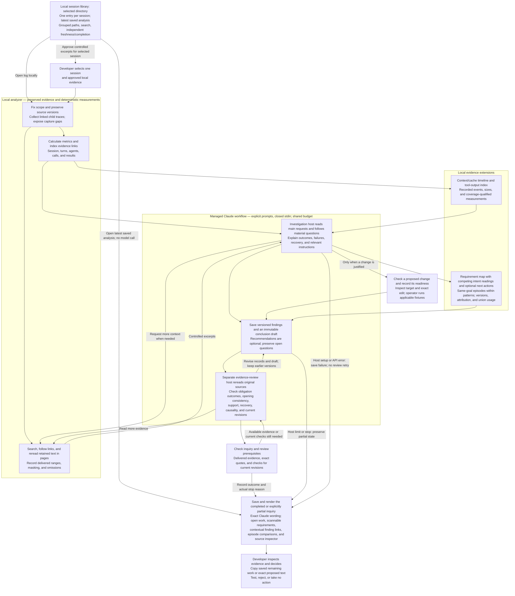

# Session analyzer design for product managers

The analyzer helps a developer decide what, if anything, should change after one Claude Code session. Recorded measurements establish what happened in the captured trace. Claude investigates the task context before judging whether an action was useful, expected, harmful, or still unexplained.

**Architecture status — October 15, 2026:** this describes the current 0.14.0 checkout and the [single-session specification](single-session-investigation-spec.md). The main flow includes the managed investigation/review workflow and document report. Requirement maps, recovery episodes, fault attribution and resource views are implemented local extensions. The validation record separates mechanical tests from actual Claude development runs. Mechanical checks establish scope, accounting, evidence delivery, and proposal prerequisites, not whether Claude's explanation is correct. Consult [implementation status](implementation-status.md) and [validation](validation.md) for observed results and remaining limits.

## From a session to a defensible decision

The diagram shows the managed `ally-session investigate` runner. Its first host saves a draft, then a separate Claude process reviews the evidence within the same overall time and money budget. One bounded review continuation is available when work remains and the budget permits. The interactive investigation skill alone does not automatically start an independent review host. A host limit or stop can leave a partial report before review finishes.

The managed host closes inherited stdin, preventing a parent pipe from joining its stage prompt. Current turn coverage excludes SDK-origin requests; their retained events remain readable. The [usefulness audit](developer-usefulness-audit-2026-10-15.md) records why empty turn coverage must not be mistaken for complete task coverage.

The plugin loads five Markdown skills and starts its local MCP server through `scripts/ally-session.py`. The runner preserves an immutable package snapshot for each investigation. Host setup or terminal API failures stop immediately; they do not trigger another reviewer.

The investigation can report a finding without recommending a change. No supported action, insufficient evidence, a partial inquiry, a failed run, and an investigation that has not run remain distinct states. A repeated call, failed test, or rejected action invites contextual investigation rather than an automatic negative verdict.

New investigations track at least one task-outcome question and preserve revisions as evidence changes the answer. The managed workflow requires all main requests to be read; this establishes exposure to intent, not fulfillment of every requirement. Completion is blocked by an open material question, unread cited evidence, or missing original results required by the saved claims. A citation to a range requires that range to have been delivered; a citation without a range requires the whole retained text record. A tool-using task's answered outcome requires primary evidence, not only the assistant's completion statement. Missing evidence can justify an insufficient-evidence conclusion; available but uninspected evidence remains unfinished work. An explicit partial report preserves that work and the actual stop reason.

Review checks belong to the current record or conclusion revision and require fresh review-stage evidence reads and exact source quotations. Revising a record invalidates its earlier positive review; earlier drafts, findings, explanations, and failed checks remain available. Completing the declared investigation does not certify developer-task completion, complete source capture, or exhaustive review of every assistant step.

The evidence extensions connect material requirements to result and verification evidence, compare the goal and scope of recovery attempts, and measure the union of their selected identities. Resource views expose recorded compactions, cache/context changes, large results, and repeated retrievals without inferring waste or causality. Fault attribution distinguishes a task gap from a defect in a particular plugin or instruction version. These additions use retained session evidence and admitted local snapshots; they do not imply live access to Ally's Jira, CI, or internal plugin repositories. Ally-specific connections and validation remain deferred until their contracts and approved evidence are available.

These checks record evidence exposure and structural prerequisites, not understanding or semantic correctness. Claude must still distinguish a command's result from completion of the user's task and interpret whether the relevant instructions applied.

“Ready for review” means the recorded evidence and checks meet the readiness policy. It does not establish benefit or authorize applying the change. Only the operator can admit files or run explicitly selected fixture checks through the CLI; Claude cannot submit a machine execution attestation through MCP. Each execution uses a fresh temporary fixture copy, which is not an operating-system security sandbox. Failed, unavailable, and unexecuted checks remain visible. Claude may revise a proposal within the production workflow, preserving its earlier wording and results.

Instruction proposals must identify their scope and the existing instructions inspected. Claude records whether a requirement was absent, wrong, ambiguous, or already present but ignored; its assessment of inventory completeness and overlap remains a model judgment. The readiness checks require inspected current snapshots, scope references, and the review. An ignored requirement does not justify appending another copy. Reusing a skill, editing an existing skill, creating a justified new skill, and changing `CLAUDE.md` have distinct proposal types.

Exact replacement or insertion text must match a unique location in the admitted target. A new file supplies its complete proposed text; an invocation is checked against the captured skill name. Matching a name does not establish that the skill is installed. Inspection computes text growth in memory and does not modify files. Useful proposals can remain drafts while evidence or tests are missing.

## What the developer sees

1. **A concrete title, synopsis, and outcome.** Claude writes and saves a one-to-three-sentence synopsis of intent, recorded work, and result or gap. A separate outcome states its evidence class and limitations. The renderer neither generates nor shortens this text.
2. **Metrics, linked turns, and subagents.** Each turn shows a literal request preview, call counts, and links to its findings. Recognized command requests display the command and argument separately; expansion retains exact fields and the original masked envelope. Ambiguous or mixed wrappers stay literal. Expanding it exposes all input/cache/output categories and original source records. Subagent controls expose linked child evidence, nested invocations, separate usage, and missing traces. Main-agent, combined, and analyzer-run usage remain distinct. A finding can link to several turns without duplicating the recommendation.
3. **Proposed changes once.** Each saved proposal appears in one place with its target, exact edit or invocation, readiness, evidence, and verification details. Earlier revisions remain available and are marked when superseded. Copy copies the literal proposed text or invocation, including its intended newlines, without diff markers or commentary. Copying does not apply or approve it.
4. **Evidence and coverage on demand.** Compact section navigation and a source inspector sit beside the report, with a full-width inspector on narrow screens. The inspector first shows Claude's saved explanation of why a citation matters, or an explicitly attributed review note for that exact record revision. Missing explanations remain explicit. Paired inputs/results, restrained syntax coloring, cited ranges, adjacent records, and full saved-source copying make evidence readable without changing it. Counted failures open their exact attempts and saved explanations. Embedding retained masked source text in an offline report requires explicit disclosure; otherwise the export preserves locators and states that text is absent. Browsing or exporting a report does not add to Claude's evidence-delivery record. Raw records remain in the local store; omitted or masked content remains identified.

Requirement status appears beside the outcome. Detailed context/cache and captured-output views sit behind Metrics, turns and child invocations; recovery resources and fault attribution sit inside their finding. They retain unknowns, scope changes and earlier versions. A successful command alone does not establish a completed requirement or recovered episode; requested response content can itself be the deliverable with explicit evidence and contextual review.

## Metrics shown before interpretation

| View | Measurements |
| --- | --- |
| Session | Reconstructed user turns, observed LLM calls, distinct tool invocations, input and output tokens, and the observed session span from the first to last retained timestamp. |
| Each user turn | Observed LLM calls, tool invocations, prompt tokens, cache reads, cache creation, completion tokens, recorded turn duration when available, and the separately labelled observed turn span. Detailed accounting also exposes uncached input. |

An observed LLM call means a distinct reconciled eligible model response in the trace; it is not a count of hidden provider retries. Prompt tokens already include cache reads and cache creation; completion tokens already include thinking when reported. The report shows those components without adding them twice. Turn boundaries and call assignment may be reconstructed from recorded order or links, with the attribution method and its limits recorded. Calls that cannot be assigned remain visible as unassigned rather than being forced into a turn.

Recorded execution durations and observed timestamp intervals are separate measures. An interval may include waiting, unrelated activity, or overlapping work and must not be labelled active work or time wasted. Missing token fields, timestamps, or child traces mean unknown or incomplete coverage, not zero. Session totals and turn subtotals reconcile through unique identities; overlapping child work is not added twice.

The expandable turn-pattern table shows **pattern**, **LLM calls per turn (median)**, **description**, **share**, linked **member turns**, and **recorded failures**. Its detailed accounting also retains tool-batch medians, turn counts, and turns with recorded failures. The groups are no recorded response, no tool calls, single tool batch, edit and check, read and search, terminal-led, and other activity. Rules apply in a fixed, versioned precedence order. Patterns describe activity; they do not diagnose waste or grade the developer.

A tool-call batch is a captured model response containing one or more tool invocations; it does not prove parallel execution. Medians describe the assigned calls and batches in member turns, with population counts retained in the details. Groups are mutually exclusive and the share denominator is every reconstructed user turn in the selected session, including requests with no recorded response. Other activity covers combinations outside the earlier rules. Unassigned calls and incomplete child coverage are displayed separately; they are not silently distributed among groups.

Recorded failure counts cover execution failures, verification-command failures, and timeouts; unknown outcomes remain separate. Tool records preserve permission denials and other outcome categories. Whether a failing test was expected or any outcome harmed the task remains a contextual investigation finding, separate from the pattern table.

## What the graph contributes

The graph is a local SQLite index of relationships. It retrieves linked call results, child traces, and parent events that a short time window might miss. Cached literal search, direct record lookup, and pageable rereading remain available. It introduces no hosted graph service or visual graph explorer.

| Relationship | What the analyzer can claim |
| --- | --- |
| A recorded call ID matches a result | A trace-supported link, with conflicts or missing results exposed. |
| A step follows another in recorded order | A navigation aid; it does not establish causation or serial execution. |
| A later change fixed an earlier failure | An attributed interpretation requiring contextual evidence. |

Graph-assisted investigation has not been shown to be faster end to end. The mechanical benchmark (`scripts/benchmark_session_retrieval.py` in the source checkout) compares local retrieval paths, including an indexed direct lookup, but does not measure Claude's diagnostic accuracy, total model usage, or developer review time. Those require the pending model-level comparison against cached, indexed retrieval without traversal and the earlier workflow. Smaller excerpts are beneficial only when the investigator can still obtain the evidence needed for a sound conclusion. See the [graph decision](decisions/0001-session-evidence-graph.md).

## Responsibilities in the current checkout

| Component | Implemented responsibility |
| --- | --- |
| [Scope and evidence](../ally_analyzer/session_scope.py) | Fixed root and admitted children; scoped lookup and graph traversal; cached text; recorded returned ranges, omissions, and limits. |
| [Session accounting](../ally_analyzer/session_metrics.py) and [turn patterns](../ally_analyzer/session_patterns.py) | Counts, token categories, duration definitions, attributed turn membership, descriptive groups, and unassigned-call coverage. |
| [Subagents](../ally_analyzer/session_agents.py) and [failure explanations](../ally_analyzer/session_failures.py) | Linked child evidence and separate usage; missing/shared-trace limits; exact counted attempts with versioned Claude explanations and recovery references. |
| [Investigation records](../ally_analyzer/session_investigation.py) | Incidents, attributed claims, measurements over explicit selections, optional recommendations, and separate run-status and conclusion records. |
| [Diagnostic prerequisites](../ally_analyzer/session_diagnostics.py) | Inquiry revisions; cited-range delivery checks; primary-result requirements; original-result inspection for supported or recovered incidents; turn evidence retrieval. |
| [Managed runner](../ally_analyzer/claude_runner.py) and [evidence review](../ally_analyzer/session_review.py) | Separate investigation/review hosts under one budget; bounded continuation; immutable drafts; fresh evidence exposure, literal quotes, current-revision checks, and explicit partial stops. |
| [Requirement maps](../ally_analyzer/session_requirements.py) | Material intent and scope changes linked to results, artifact revisions, and verification; duplicate merging and preserved supersession/withdrawal; narrower or stale checks remain qualified. |
| [Recovery episodes](../ally_analyzer/session_episodes.py) | Explicit attempts and same-goal verification prerequisites, union resource accounting, and version/evidence qualifications for fault attribution. Meaning and causal support remain Claude judgments. |
| [Resource views](../ally_analyzer/session_resources.py) | Per-agent context/cache events, peak observed input, captured tool-output sizes and retrieval groups, with scoped identities, known populations, and unknown values. |
| [Edit inspection](../ally_analyzer/session_edits.py) | Exact text anchors, invocation matching, candidate consistency, and text-growth measurements without applying changes. |
| [Validation](../ally_analyzer/session_validation.py) | Operator-selected snapshots and fixtures; proposal-bound results; `readiness-v2` instruction inventory, scope, overlap-review, and evidence prerequisites. |
| [Claude investigation](../skills/investigate/SKILL.md) and [writing](../skills/write-report/SKILL.md) | Versioned procedures for contextual investigation, evidence review, precise instruction interventions, and the stored synopsis and observed outcome; each skill declares its current version. |
| [Report renderer](../ally_analyzer/session_report.py), [styles](../ally_analyzer/session_report.css), and [interactions](../ally_analyzer/session_report.js) | An offline HTML document and JSON export preserving saved wording; section navigation, paired evidence inspector, token details, proposals, exact copying, check states, coverage, and history. |

The CLI and MCP expose the same investigation operations. The bound MCP workflow rejects another investigation ID and legacy APIs that could escape the selection. Artifact admission and fixture execution remain operator interfaces. The local engine checks identities, scope, calculations, versions, and recorded test results. Claude assesses meaning and support; those assessments remain model judgments. Codex develops and tests the product and does not rewrite its production recommendations.

Existing runs remain readable under their saved contract and readiness policy. The report explicitly identifies a legacy saved conclusion when no separate synopsis was recorded; it does not manufacture a retrospective synopsis, new evidence receipts, or a claim that the old run passed the new prerequisites.

## Validation and remaining product evidence

The contract tests (`tests/test_session_workflow.py`, `tests/test_session_diagnostics.py` and `tests/test_session_evidence.py` in the source checkout) exercise scope rejection, accounting, unknown data, retrieval, evidence prerequisites, inquiry revisions, instruction readiness, exact edits, report-source disclosure, and output preservation. They include unread original results, unsupported execution claims versus requested text delivery, narrowed/stale verification, overlapping recovery episodes, matched resource populations, unavailable versus merely uninspected evidence, and duplicate instruction proposals. These tests establish behavior for their fixtures. They do not establish that Claude identifies every material issue, that an instruction inventory is truly complete, that selected fixtures adequately test a proposal, or that a recommendation will help in practice.

A useful report lets the developer locate the evidence, understand uncertainty, and decide whether a concrete next step is warranted. Held-out evaluation must assess unsupported claims, false alarms, missed material issues, recommendation validity, and review effort using untouched Claude outputs. Model-level graph comparisons and quality superiority over `/insights` remain unestablished. Cross-session prevalence, developer rankings, automatic application of changes, and a graph explorer are outside this release.
