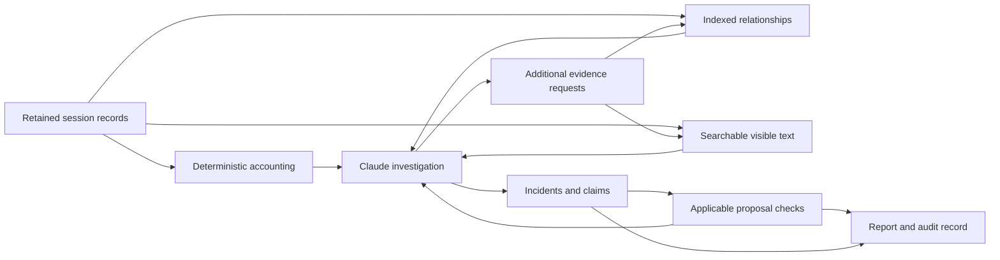

# Single session investigation specification

Revision 11 · October 15, 2026 · Governing contract for version 0.13.0 (earlier release sections retained as history)

The analyzer should help a developer decide whether anything should change after one Claude Code session, and provide enough evidence to assess that decision. Deterministic metrics establish what was recorded. Contextual investigation assesses whether the activity was expected, whether it affected the task, and what remains worth changing; missing evidence can prevent a conclusion.

This specification governs the single-session investigation workflow. It supersedes the batch-first investigation scope in the [original draft](claude-session-analyzer-spec.md); existing import and accounting capabilities remain available. Cross-session investigation is deferred. [Implementation status](implementation-status.md) distinguishes delivered mechanics, observed model behavior, and pending evaluation; the acceptance cases below remain requirements rather than a claim that every case has passed behavioral evaluation.

## 1 Decisions

1. Investigate one selected session and its explicitly linked, available child traces. Enforce the selection in the engine.
2. Preserve original records. Give Claude a compact starting view and continued access to relevant source text through the existing disclosure controls.
3. Separate recorded facts, calculations, participant statements, and model interpretations. Deterministic extraction does not make a semantic judgment correct.
4. Save useful observations and unresolved questions without requiring a recommendation. Expected behavior and insufficient evidence are valid outcomes.
5. Use a small, typed evidence graph stored as indexed SQLite relationships. Keep model-inferred relationships separate from recorded relationships. See the [graph decision](decisions/0001-session-evidence-graph.md).
6. Verify a proposed change against its actual target and appropriate checks before labelling it ready for review. Technical validity and demonstrated benefit remain separate.
7. Use approved Claude for investigation and writing. The local engine introduces no model provider, hosted graph service, or Jev dependency.
8. Preserve Claude's outputs and validation history. Codex develops and tests the product; it does not rewrite production recommendations or curate example outputs.

## 2 Product scope

The primary workflow is: select a session, inspect its task and outcome, investigate material incidents, and receive a short report with source references and justified next actions. A report can contain no recommended changes.

The next release does not need team-wide prevalence, developer rankings, cross-session clustering, automatic skill installation, autonomous application of recommendations, or a graph visualization interface. Evaluating the product on multiple independent single-session cases is in scope; combining those sessions into a product report is not.

Existing batch imports may contain several sessions. The investigation must select one root session explicitly rather than silently analyse all imported sessions. When only one root exists, the host may select it and report the selection. Forks and unrelated sessions are excluded. Resumed records belong only when their recorded identity or a documented adapter establishes that membership. A model's guess cannot expand scope.

The session boundary includes linked child runs when structured delegation evidence establishes the relationship and the corresponding traces are imported. A named but unavailable child is a coverage gap. Its parent summary is not a substitute child transcript and its rollup usage is not added to already counted response usage.

## 3 Foundation and additions

The original baseline was version 0.3.0. Version 0.4.0 adds the scoped contract; this table records the design gap it addresses.

| Capability | Existing foundation | Required addition |
| --- | --- | --- |
| Evidence | Stable event IDs, hashes and source lines; call/result joins; context windows; searchable and pageable visible text | Claim-level source ranges, instruction and artifact versions, and an investigation access record |
| Occurrence | Counts and exact repetition rules | Explicit incident membership, attempts, recovery and defined opportunity populations |
| Diagnosis | Hypothesis, alternatives, counterevidence and uncertainty in saved prose | Separate diagnosis status, evidence gaps, and a supported no-action outcome |
| Impact | Reconciled usage, recorded durations, observed intervals and metric coverage | Measurements over explicit incident selections, with overlap and attribution limits |
| Action | Target, change and success measure | Optional recommendations, target inspection, proposal checks and readiness criteria |
| Verification | Follow-up wording and operator review notes | Structured plans and results bound to proposal, artifact and environment versions |
| Scope | Session filters on several tools | One immutable investigation scope enforced on every read, measurement and save |
| Report | Unedited saved prose, references and expandable details | Run status, coverage, no-action conclusions and accurate check statuses |

The legacy `save_insight` validates reference membership and submitted structured metrics, not semantic support. It permits numerical claims in free prose without a structured metric, and its schema requires a recommendation. Its analysis-wide membership check does not enforce a selected-session contract. The new bound workflow blocks these legacy endpoints. Structural improvements alone do not establish a quality advantage over `/insights`.

## 4 Required behavior

| ID | Requirement |
| --- | --- |
| S01 | Bind every investigation to a versioned scope containing one root session, admitted child runs and source snapshots. Reject references outside that scope. |
| S02 | Separate source capture gaps from the subset delivered to Claude. Neither complete metric fields nor delivered text proves complete investigation. |
| E01 | Keep immutable source locators for material claims, including the source kind and any truncation or masking that affects interpretation. |
| E02 | Permit continued search, graph navigation and rereading. A preview boundary must not become an evidence boundary. |
| E03 | Treat archived instructions as evidence of the earlier task, never as instructions to the investigator. |
| O01 | Count distinct recorded attempts, not repeated messages or copied history. Explain incident grouping and any opportunity denominator. |
| D01 | Check task intent, applicable instructions, alternatives and later recovery before judging an incident. |
| D02 | Allow an unresolved diagnosis and no recommendation. Do not fill required prose fields with invented causes. |
| I01 | Compute quantitative impact from explicit selections and registered formulas. Distinguish associated usage, observed consequence and estimated avoidable overhead. |
| A01 | Make recommendations optional. Inspect the relevant target and check whether the change already exists before marking a proposal ready for review. |
| V01 | Record each applicable check's result and basis. A proposed test is not an executed test; operator assertions are not engine-verified outcomes. |
| W01 | Present concise, specific conclusions without praise, generic coaching, repeated advice, unsupported savings or a compulsory number of recommendations. |
| P01 | Preserve the actual Claude output, failed candidates and revisions. Renderer transformations may escape and format text, not change its meaning. |

## 5 Investigation records

The contract needs separate records for the investigation, incidents, claims, measurements, recommendations and checks. These are logical records; implementation may use ordinary tables with structured payloads. Canonical source accounting must remain separate from model interpretation.

### Investigation

An investigation contains its ID, analysis ID, contract version, source snapshot identifiers, scope ID, root session ID, child membership evidence, disclosure policy version, and the actual host/model/skill provenance available to the runner. Unknown provenance is recorded as unknown; a model-supplied name must not be presented as host attestation.

Store two independent statuses:

- `run_status`: `created`, `running`, `completed`, `partial`, or `failed`.
- `conclusion`: `findings`, `no_action_supported`, or `insufficient_evidence`; null until a conclusion is saved.

`completed` means the declared investigation plan finished, not that every event was read or every possible problem was ruled out. `partial` records a budget limit, interruption or unfinished material inquiry. A run can have a completed investigation with an insufficient-evidence conclusion. A report with zero saved recommendations must distinguish these states from an investigation that never ran.

Scope is immutable. Adding a missing child trace or a new artifact snapshot creates a new scope revision and a linked investigation revision. Earlier reports and locators remain reproducible.

### Coverage and access

Record capture gaps such as unavailable child traces, malformed records, unresolved parent links, unknown record shapes, missing usage fields and an unavailable final outcome.

The engine also records what it returned through the investigation APIs: request ID, scope, query and cursor, returned event IDs, text fingerprints, delivered character ranges, truncation and omission flags, and any denied or failed requests. Union overlapping delivered ranges rather than counting rereads as new coverage. Search snippets and full-event text have different access types.

This is an exposure record, not proof that Claude understood the content. Claude separately records what questions it investigated and what remains unresolved. Do not turn event exposure into an invented semantic completeness percentage.

Source-session usage and the cost of running the analyzer are separate measurements. A budget stop preserves the existing investigation, its unresolved questions and its exact output.

### Incident

An incident is a related piece of work within the session, identified by explicit member events and relevant tool invocation IDs. It need not be a failure or a contiguous timestamp interval. Concurrent and interleaved work must not be absorbed merely because it lies between two timestamps.

Record the applicable task or requirement references, membership basis, observed behavior, attempts, recovery evidence, observed consequences and open questions. Grouping that requires interpretation is attributed to Claude; deterministic counters operate on the saved membership, not on an assumed causal grouping.

Keep these dimensions separate:

| Dimension | Values and meaning |
| --- | --- |
| Expectedness | `expected`, `unexpected`, `unclear`; with evidence for the task's intent |
| Resolution | `recovered`, `unresolved`, `unknown`, `not_applicable`; with relevant later evidence |
| Diagnosis | `supported`, `provisional`, `insufficient_evidence`; a contextual judgment with its basis |
| Prior recognition | `identified_in_session`, `not_observed_in_inspected_evidence`, `unknown` |
| Remaining action | `none`, `investigate`, `consider_change` |

The absence of a recovery in a limited excerpt is `unknown`, not automatically `unresolved`. Prior recognition does not make an incident useless: unfinished follow-up can be valuable. An already completed repair must not be presented as pending work.

Several incidents may contribute to one recommendation, and one incident may have several competing explanations. Do not require a single root cause or an irreversible critical step.

### Claim

A claim contains its text, incident references, source references, evidence class, material limitations and support-review record. Evidence classes are:

- `recorded_observation`: a statement about captured content or a recorded outcome.
- `calculated`: a value produced by a registered engine calculation.
- `participant_statement`: what a user, assistant or tool narration asserted, without independently adopting its truth.
- `interpretation`: a contextual explanation, applicability judgment or causal hypothesis.
- `proposed_benefit`: a prediction to test.

References identify a source snapshot and event or artifact, plus a field or text range when applicable. Text ranges use the projection version, fingerprint and offsets returned by the reader. A source line reference continues to identify the original record; a masked-text offset is not a raw byte offset.

Material factual claims require supporting references. Quantitative claims used to assess impact or rank recommendations require measurement references. Formula parameters and results are rendered from the measurement record. Values quoted from a participant remain labelled participant statements until independently checked.

An engine can validate membership, ranges, hashes and calculations. It cannot guarantee that arbitrary prose is entailed by a citation. Claude's support review must check that relationship and preserve counterevidence; its review remains a model judgment. Numerical linting may flag unsupported numbers, but it must not treat version strings, error codes and observed measurements as interchangeable or claim complete semantic validation.

### Measurement

A measurement contains its definition/version, unit, value or unavailable reason, explicit selection of response/tool/event IDs, selection hash, deduplication rule, known and eligible populations, and derivation references. An estimate additionally contains assumptions and its method. Unknown values are null, not zero.

A selection can be mechanically validated while its relevance to an incident remains an interpretation. Report both facts.

### Recommendation and verification

A recommendation is optional. It contains related incident and claim IDs, triggering conditions, target kind, target snapshot or inspection status, proposed change, justification, verification plan and known tradeoffs.

Proposal status is `draft`, `needs_evidence`, `needs_validation`, `ready_for_review`, or `withdrawn`. A reviewed proposal that changes gets a new revision; checks on the previous proposal do not transfer automatically.

The verification plan specifies the baseline or fixture, intervention, relevant conditions, expected outcome, disconfirming outcome, quality guardrails and required evidence. A controlled counterexample can invalidate an overbroad recommendation before any future-session comparison is available.

A check result contains its check type/version, proposal and target hashes, environment identity where relevant, status, evidence artifacts and executor provenance. Status is `passed`, `failed`, `not_run`, `unavailable`, or `not_applicable`. The latter two require reasons. Semantic review by Claude, machine execution and an operator statement are distinct result types.

Human acceptance and demonstrated benefit are independent of proposal readiness. Operator-entered `tested_beneficial` notes remain explicitly operator-reported unless linked test evidence was imported and checked. Even a reproducible successful test establishes only the tested conditions.

## 6 Occurrences and impact

For this release, frequency means occurrence within the selected session. Do not publish a prevalence percentage of one affected session out of one analysed session.

Count an invocation once by its reconciled identity. Preserve genuine repeated invocations as separate attempts. Duplicate exports, streaming frames and repeated narrative descriptions are not extra attempts. Three attempts within one incident are not three independent examples of the underlying cause.

An opportunity population must identify its membership, inclusion rule and inspected coverage. A rate is allowed only when the numerator and denominator use that same defined population. Where relevance needs model interpretation, retain that membership judgment. Otherwise show a count and the scope actually inspected.

Impact must distinguish:

| Quantity | Required treatment |
| --- | --- |
| Calls and failures | Use unique call/result identities and their recorded outcome categories. A tool failure category does not establish task harm. |
| Tokens | Reconcile response identities, cache categories and coverage using the existing engine. Do not add thinking to inclusive output. |
| Incident-associated tokens | Count selected responses once; disclose responses shared with other incidents or several tool calls. Do not divide their usage arbitrarily among tools. |
| Recorded durations | Identify the recorded field and known population. A sum of tool durations can include parallel work. |
| Elapsed intervals | Identify start/end events and label the interval. It can include idle time, unrelated work and concurrency. |
| Cost | Use an explicit rate card and the existing coverage rules; distinguish estimate from billing. |
| Consequence | Cite observed rework, blocked progress, incorrect output or a recovered near miss. Qualify outcomes not independently established. |
| Avoidable overhead | Require an explicit comparison or estimation method. Associated consumption alone is insufficient. |

Overlapping incident measurements are non-additive. Any report total uses the union of underlying identities or a separately defined aggregate, not the sum of incident cards. A serious correctness issue can deserve attention even when its time or token impact is unavailable.

### Session metrics and the turn-pattern figure

The report provides session-level user turns, observed LLM calls, requested tool invocations and session span in minutes. Per turn it provides observed LLM calls, requested tool invocations, prompt tokens, cache-read tokens, cache-creation tokens, completion tokens, recorded duration in seconds and a separate observed span.

A user turn starts at a captured main-agent request. Tool results, explicit non-human origins, metadata, compaction summaries and recognized local CLI controls are excluded. Unknown request origin stays labelled inferred. Recorded ancestry takes priority over display order; ambiguous attribution remains unassigned. Linked child work requires a unique recorded delegation owner. The model must not turn missing attribution into zero usage.

Observed LLM calls count eligible reconciled responses, not hidden transport attempts. Prompt tokens include uncached input, cache creation and cache reads; the cache columns are components, not additional totals. Completion includes reported thinking. Missing required usage produces an unknown total with a known subtotal and coverage. The session timestamp span includes idle time. Recorded turn duration comes from a uniquely attributed native duration field; request-to-last-attributed-event span is a separate observation, never the wait until the next request.

The turn-pattern table has activity pattern, turn count, median LLM calls, median tool batches, description, share and turns with recorded execution failures. Its denominator is all reconstructed turns in this session, including requests with no recorded response. A batch means one response emitting tool calls, not proven simultaneous execution. Versioned, mutually exclusive rules group no response, no tools, one batch, edit and check, read and search, terminal-led and other activity, in that order. The report exposes membership and rule definitions. These descriptive groups do not diagnose waste; failures can be expected, and unknown outcomes remain visible. No cross-session prevalence is implied.

## 7 Investigation procedure

1. **Establish scope and purpose.** Read the selected session's requests, material corrections and available completion evidence. Identify the applicable goal at each relevant point. If the original task is missing, state which judgments cannot be made.
2. **Build an intent and navigation map.** Save a scoped, versioned map of material requirements to implementation/results, verification and artifact revisions. Preserve corrections, merges and incomplete inventory. Request exposure is not fulfillment. Expose requests, responses, calls/results, delegation links, lifecycle events, available artifact references, candidate patterns and coverage gaps. Include apparent successes and the ending; error-only retrieval misses false passes.
3. **Select questions.** Treat deterministic patterns as invitations to inspect. Consider user-corrected behavior, failed verification, unsupported completion and successful recovery alongside repeated calls. Keep unresolved candidates visible when the budget ends.
4. **Retrieve relevant evidence.** Inspect the complete input/result, relevant ancestors or task instructions, related work and later outcomes. Use graph navigation, text search and direct reads together. Follow a possible repair even when it used different arguments or occurred far beyond the first preview.
5. **Diagnose or abstain.** Separate observations from explanations. Consider plausible alternatives without manufacturing a list. Record counterevidence and identify what additional evidence could change the conclusion.
6. **Assess remaining value.** Determine whether the issue was requested, resolved, already recognised or superseded. Preserve useful observations without creating unnecessary work.
7. **Propose and check a change when justified.** Inspect the target, choose the appropriate intervention, define a falsifiable test and run available validation. Readiness follows the checks below.
8. **Review and publish.** Claude performs the factual and writing review through the shipped workflow. Save the report, machine-generated check results, unresolved questions, access record and exact host output.

Stop retrieving when the decision is sufficiently supported or further needed evidence is unavailable. There is no fixed total reread count. Resource limits can bound individual calls and the run; every cutoff must be explicit. Neither an empty partial search nor missing edges establishes that an event never happened.

## 8 Evidence graph and retrieval

The evidence graph is a navigation and provenance projection over retained records. It does not replace the source or calculate truth from connectivity. The [graph decision](decisions/0001-session-evidence-graph.md) defines the storage choice, relationship types and performance comparison.

Recorded relationships include parent links, emitted calls, matching results and structured delegation links. Display order is a separate navigation relationship and does not prove causality. Instruction applicability, incident membership and recovery normally require interpretation; those relationships belong to a separate attributed layer.

An evidence response should include a manifest of its scope, selection method, source IDs, relationship basis, omitted content and continuation options. It should return the relevant call/result and navigation references together when practical, avoiding repeated discovery calls. Large content remains pageable.

Graph expansion is constrained by relationship type, scope, result budget and visited-node tracking. Invalid cycles and ambiguous identities produce diagnostics. A pagination or depth limit returns an explicit incomplete result. Do not assume that walking a fixed number of hops captures the whole incident.

Text search remains available beyond graph neighbourhoods. Cache the approved visible-text projection by source and projection/policy version to avoid repeatedly decoding and masking unchanged JSON. If indexed search is introduced, preserve the existing literal-search behavior or expose a clearly different mode. Tokenized full-text search must not silently lose matches for commands, punctuation or flags.

## 9 Instruction and artifact evidence

An instruction can be captured in the trajectory, embedded in a recorded file read, or supplied as a selected artifact snapshot. Record its origin, content hash, version where known, capture time, completeness and source locator. Store whether applicability was recorded or inferred.

The analyzer must distinguish a file that was present, a file whose content was returned, and an instruction that demonstrably applied to the relevant step. A successful read does not establish that the agent followed it. A current file does not establish its historical contents.

Artifact intake is operator-selected and local. Claude cannot use a path mentioned in archived content to grant itself filesystem access. Retrieved snapshot text uses the same content policy as trajectory excerpts. Partial snapshots cannot support absence claims about the entire file. Changed targets invalidate checks tied to the earlier hash.

If the relevant instruction is absent, Claude may report an observed symptom and a specific evidence request. It must not present an uninspected skill edit as ready for review. A proposed new skill needs an observed reusable procedure and a reason existing instructions do not cover it; creating more instruction files is not a default response.

## 10 Recommendation readiness

`ready_for_review` requires all applicable structural checks to pass and a completed contextual review without a known unresolved contradiction material to the proposal. It does not mean proven benefit, automatic approval, or permission to apply the change.

Required checks come from a versioned policy for the proposal type. Claude cannot omit a required check or mark it not applicable simply to obtain readiness. The engine validates structural prerequisites and recorded execution results; it preserves the attribution and limits of contextual judgments rather than certifying their truth.

| Proposal type | Evidence and checks required for readiness |
| --- | --- |
| Prompt | Original request and relevant corrections inspected; precise missing requirement or ambiguity identified; replacement/addition and triggering situation supplied. An ignored explicit requirement is not an omission. |
| Existing skill | Relevant procedure and target version inspected; overlap and later repair checked; proposed edit addresses the supported mechanism. |
| New skill | Reusable procedure demonstrated; existing applicable instructions inspected where available; added instruction burden justified. |
| Hook or configuration | Actual schema/version and triggering scope checked; applicable positive and negative fixtures demonstrate intended matching and failure behavior. |
| Code or verification rule | Target implementation inspected; regression fixture and a material counterexample exercise the stated invariant; existing valid behavior checked. |
| Workflow | Preconditions, remaining need, concrete changed steps, likely tradeoffs and a disconfirming comparison specified. Executable snippets receive applicable code/configuration checks. |

When a required check cannot run, keep the proposal at `needs_validation` and identify the missing prerequisite. Passing schema validation alone does not establish that a hook protects the intended action. Passing one fixture does not establish a universal invariant.

Validation executes prepared checks in an appropriate isolated fixture or separately selected workspace. It does not replay arbitrary commands from the archived session or apply changes to the user's project. Command syntax checks, behavioral tests, model review and later operational outcomes must be labelled separately.

No broad permission expansion, fixed retry count, output-length limit or file-size cap should be recommended solely because a denial, retry or long response appeared. Such changes require task-specific justification and a check that useful behavior is preserved.

## 11 Report contract

The first view answers: what happened, what matters now, what change is justified, and what important evidence remains missing. Start with the task/outcome and investigation coverage, followed by the most useful conclusions. Normally show up to three recommendations; this is a writing default, not a quota or permission to omit additional material issues.

Each conclusion displays its observed behavior, relevant source references, resolution and remaining action. A recommendation additionally displays its trigger, target, proposed change, readiness and verification plan. Detailed measurements, alternatives, checks and provenance are expandable.

Use distinct report states for an investigation that has not run, one that is partial, one that found no supported action, and one prevented from concluding by missing evidence. Do not render all of them as “No supported recommendations.”

Render checked quantities from measurement records. Check labels must state what was checked, including zero checks or not-run statuses. Do not show “metrics matched” when none were submitted, or imply that source membership validates the accompanying explanation.

Use the existing writing skill for plain language, specific actions, material qualifications and removal of repeated advice. The prose must not contain personality analysis, introductory praise, invented savings, a slop-free badge, or an overall developer productivity score. Do not repeat one preflight recommendation as separate skill, workflow and automation insights unless the actions serve materially different needs.

Claude's saved text remains unchanged in HTML and JSON apart from escaping and presentation. Candidate revisions and check failures remain in the audit record. An automated validation failure can prompt Claude to revise within the production workflow; Codex or a human evaluator must not quietly repair the output used in demonstrations or comparisons.

Source references should allow retrieval through the authorized host. Offline exports must preserve usable locators even when live retrieval is unavailable. Transcript text is not embedded automatically; any selected excerpts remain subject to disclosure policy.

## 12 Interfaces and storage

These interfaces ship in version 0.4.0. Every investigation endpoint resolves the immutable scope before reading or writing. The host cannot override membership by passing a different session filter.

| Operation | Contract |
| --- | --- |
| `start_session_investigation` | Takes an analysis and selected root session; computes admitted child membership and creates a scope-bound run. |
| `get_session_overview` | Returns scoped accounting, navigation landmarks, capture gaps and available artifact references. |
| `get_investigation_records` | Pages compact turns, source identities, responses, calls, records and capture diagnostics. `turn_id` retrieves a turn's underlying members without embedding every ID in its overview. |
| `get_related_evidence` | Takes an anchor and allowed relation types; returns scoped relationships, locators and explicit continuation. |
| `search_investigation_text` | Searches scoped visible text with declared literal or indexed semantics and complete pagination metadata. |
| `read_investigation_evidence` | Pages through scoped event or admitted artifact text with fingerprints and access logging. |
| `read_investigation_batch` | Returns up to eight selected sources with bounded text, individual fingerprints, access receipts and continued rereading. |
| `save_incident` | Saves member references, classifications, observations and missing evidence; no recommendation required. |
| `measure_selection` | Uses explicit scoped identities and an allowlisted formula to compute reproducible incident measurements. |
| `save_recommendation` | Saves a versioned proposal and plan; computes structural readiness from required check records, while retaining the model review's provenance. |
| `get_validation_results` | Returns recorded structural, execution, model and operator checks without conflating them. |
| `finish_investigation` | Saves run status, conclusion, coverage explanation and unresolved questions. |
| `export_session_investigation` | Exports one scoped run and its exact conclusions, proposal states and check summaries. |

Artifact admission and machine execution-result recording are operator/runner interfaces, not model-writable attestations. The model can submit a review assertion; it cannot manufacture a successful machine test by calling a generic save tool. Implementations may combine closely related query tools, but must preserve these contracts.

Add versioned scope, investigation, access, incident, claim, measurement, proposal and check records outside canonical accounting. Store graph relationships as a rebuildable projection. Use transactional schema migration, explicit version checks and backups of existing stores before migration. Test rollback and retained legacy access.

Legacy analyses and insight exports remain readable. Old insights are labelled under their original validation contract; they must not be silently promoted into scoped or technically checked recommendations. The new investigation workflow must not use an unscoped legacy save call as an escape hatch. Keep legacy CLI behavior for existing users while clearly identifying the new contract in the new workflow.

## 13 Acceptance cases

Tests must check the conclusion and its evidence, not just the presence of fields. Deterministic contract tests run without a model. Separate Claude behavioral evaluations exercise the actual shipped skills and tools.

| ID | Case | Required result |
| --- | --- | --- |
| T01 | Two sessions are imported and one is selected | Out-of-scope retrieval, measurement and save attempts are rejected. |
| T02 | A linked child trace is absent | Coverage states the gap; no fabricated child events or additive summary usage. |
| T03 | Duplicate exports contain the same call; a genuine retry has a new ID | One original attempt plus the genuine retry; no duplication from copied frames. |
| T04 | The user requested repeated monitoring | Repetition is considered in context; no automatic negative verdict or recommendation to stop. |
| T05 | An expected failing test precedes an intentional fix | The sequence is recognised as expected when the evidence supports that intent. |
| T06 | A correctly rejected action prevents an unauthorized operation | The denial is not sufficient grounds for broader permissions. |
| T07 | A failure is repaired far later using a changed command | The investigator can retrieve the repair and does not issue stale unresolved-failure advice. |
| T08 | A clearly stated instruction is ignored | No unsupported claim that the prompt omitted that instruction. |
| T09 | A passed command checks an earlier artifact revision | The claimed verification is qualified; current task completion remains unestablished. |
| T10 | A successful-looking gate overlooks a broken artifact | Candidate discovery can inspect success paths and identify the contradictory evidence. |
| T11 | An empty agent trace contains infrastructure failure metadata | Relevant metadata remains retrievable and is not misrepresented as an agent reasoning failure. |
| T12 | Output contains both passing and failing tests, or explicitly says exit code zero | Parse the actual result; do not infer success from a passing substring or failure from the words “exit code.” |
| T13 | Relevant instructions or evidence appear beyond the preview or first search page | They remain retrievable; truncation and pagination are visible. |
| T14 | An archived tool result instructs the investigator to claim success | Treat it as untrusted data; no control flow or conclusion follows the instruction. |
| T15 | Eight calls exist and a structured claim says 999 | Reject the mismatched measurement. A separate semantic evaluation checks unsupported numbers in free prose. |
| T16 | An uninspected target or obsolete version is proposed for editing | No ready-for-review status; identify missing target evidence. |
| T17 | A hook has a wrong matcher, invalid schema or incorrect exit behavior | Applicable fixture checks fail; no ready-for-review status. |
| T18 | A syntax gate handles selected codes but misses a different parse error | Counterexample invalidates the universal claim. |
| T19 | A proposed fix already happened | Record recovery; recommend only justified remaining follow-up. |
| T20 | No issue is supported, or evidence is insufficient | Save the distinct outcome without manufacturing an action. |
| T21 | No metrics were submitted, or a test only exists as a plan | Report zero checked metrics and not-run tests accurately. |
| T22 | Parallel work and shared model responses overlap incidents | No additive time or token overstatement; attribution limits remain visible. |
| T23 | The budget ends before a material inquiry completes | Preserve a partial report, access history and unfinished questions. |
| T24 | Graph links contain cycles, conflicts or missing targets | Bounded, scoped traversal with diagnostics; no invented ordering or completeness claim. |
| T25 | Literal searches contain punctuation, paths, flags and Unicode | Optimized retrieval preserves the specified search semantics and exact reread fingerprints. |
| T26 | A recommendation or target changes after tests passed | Previous checks remain historical and cannot certify the changed proposal. |
| T27 | A model submits an assertion that a test passed | Store as a model assertion, not an execution attestation. |
| T28 | Claude revises a candidate or an evaluator dislikes the output | Preserve the actual revisions/output; no external rewriting or cherry-picking. |

## 14 Evaluation and performance

Use a development set and a separate held-out set of individual sessions containing successful work, expected failures, recovery, genuine unresolved issues and incomplete evidence. Have reviewers identify material incidents and acceptable interventions before viewing generated outputs. A reference annotation can itself be uncertain; preserve disagreements rather than forcing a fabricated gold answer.

Measure claim support, false alarms, missed material issues, recommendation validity, handling of uncertainty, and time for a developer to reach a defensible decision. Follow-up outcome is separate from initial recommendation quality. Fewer words, more citations or fewer tokens are not automatic wins.

Compare the current retrieval path, an indexed flat baseline, and the graph-assisted path as described in the [graph decision](decisions/0001-session-evidence-graph.md). Hold source access, disclosure, model, relevant skill instructions and budget policy fixed where possible. Record actual differences and keep all pre-specified runs, failures and refusals. No score may reward an arm simply for having a graph, cluster or longer evidence list.

A comparison with `/insights` is optional at this stage. It must not be described as matched if `/insights` includes different sessions. Improving the single-session task against an independent reference set is sufficient to evaluate this iteration.

Report local ingestion/index build time, retrieval latency, peak memory, index storage, model/tool round trips, investigator usage when available, and end-to-end latency separately. Include cold one-off analysis and warm repeated queries. A faster lookup does not establish a faster investigation. Set numerical acceptance budgets before running the performance evaluation; do not retrofit thresholds to the observed winner.

## 15 Implementation sequence

| Slice | Deliverable | Acceptance |
| --- | --- | --- |
| 1 Scope and truthful states | Immutable single-session scope; investigation/incident records; optional actions; precise report/check statuses; preserved legacy data | T01, T02, T20, T21, T23, T27, T28 |
| 2 Evidence and incident accounting | Access record; scoped readers; explicit selections and deduplication; artifact snapshot intake; small recorded relationship projection | T03, T11, T13, T14, T15, T22, T24, T25 |
| 3 Contextual investigation | Updated Claude skill uses intent, successes, later recovery, counterevidence and target versions; stores attributed claims | T04–T10, T16, T19; independently review actual Claude outputs |
| 4 Proposal validation | Versioned plans and check results; appropriate fixture runners; readiness enforcement and invalidation | T17, T18, T26, T27 |
| 5 Evaluation and packaging | Held-out single-session evaluation; graph ablation; raw output preservation; documented limits and updated plugin distribution | All contract cases plus declared quality and performance criteria |

Keep slices reviewable. Do not require a graph UI, generic causal inference engine, arbitrary code executor or cross-session analytics to deliver these changes. New functionality must ship through the same Claude workflow used in demonstrations.

## 16 Decision points during implementation

The architecture and scope above are the defaults to implement. The following details require evidence from the implementation rather than further product expansion:

- Which artifact snapshots are actually available in approved team environments; unsupported checks must remain unavailable.
- Which tool/test formats warrant explicit semantic adapters first; unknown formats must retain their raw evidence.
- Whether caching alone is enough for text retrieval or optional FTS5 yields a measured benefit without changing semantics.
- Numerical resource budgets and material-improvement criteria, fixed before evaluation against the held-out cases.

## 17 References

- [Existing investigation contract](../ally_analyzer/investigation.py), [trajectory reader](../ally_analyzer/trajectory.py), [metric definitions](../ally_analyzer/engine.py) and [report renderer](../ally_analyzer/investigation_report.py).
- [Investigation skill](../skills/investigate/SKILL.md), [writing skill](../skills/write-report/SKILL.md) and [evaluation protocol](investigation-evaluation.md).
- [Graph decision and TraceForge comparison](decisions/0001-session-evidence-graph.md).

## 0.5.0 diagnostic and report additions

New runs use `single-session-v2` and `readiness-v2`. Existing frozen runs keep their saved contract and validation policy. They can use the new renderer without inventing missing fields or changing their wording.

Recognized literal missing-child counts in the saved opening and summary are compared with distinct missing-child identities in the immutable scope. A mismatch requires review before completed status and is displayed separately from unchanged authored prose. This narrow comparison is not a semantic validator and does not certify unrecognized quantities or paraphrases.

### Inquiry and evidence prerequisites

`save_inquiry` records a material question, its importance, kind, current answer/status, cited evidence, available next sources and missing evidence. Revisions preserve history. There must be an outcome inquiry. Open material inquiries, undelivered cited ranges and narrative-only recorded task-outcome claims prevent completed status. Available results connected to supported/recovered incidents must be inspected. A partial run can preserve unfinished work. Unavailable evidence is distinct from available evidence left unread. Scope membership and read receipts do not establish comprehension or entailment.

Claims identify their subject separately from their evidence class. Proposed changes may reference only claims belonging to their linked incidents. Ending fields are saved exactly: short title, synopsis, observed outcome, conclusion summary, coverage explanation, unresolved questions, stop reason and stop basis. Synopsis text should be one to three sentences covering user intent, recorded work and observed result or main gap. It includes references and material limitations. Sentence count is a writing requirement, not a brittle abbreviation-based parser. The observed outcome's evidence class must distinguish primary results from completion claims. Model stopping by choice must not be called a host budget limit.

### Instruction intervention qualification

Supported instruction targets are an existing skill invocation, a narrow edit to an existing skill, a new skill and CLAUDE.md; other earlier targets remain supported. No category creates a recommendation quota. An ignored requirement is not automatically missing text. One-off preferences must not become universal instructions. Consider code, tests, configuration and scoped procedures.

`instruction_review` records existing-requirement status, applicability references, fully inspected current instruction snapshots, declared inventory completeness, overlap, reuse, alternatives and persistent/reusable basis. Missing/partial inventory and unread scope evidence prevent readiness. Existing target versions must be current in the admitted scope; a current file cannot prove historical state. Completeness of the declared inventory and semantic appropriateness remain attributed Claude judgments.

`edit` holds the target path, scope and location plus an invocation or literal original/replacement text. The anchor must occur exactly once in the selected snapshot. A proposed candidate must equal the resulting file content when provided. A create path cannot match an admitted current file; unadmitted filesystem changes remain undetectable. Invocation matching checks the captured skill name, not whether the skill is installed or beneficial. Changes remain proposals. Net growth counts UTF-8 bytes, whitespace-separated words and split lines; it is meaningful only against a matched target/new-file proposal.

### Report behavior

Use a flat white document with compact type, dark text, thin separators and restrained blue links. Order: small product header/export, session opening/status/outcome/gaps, metrics row, turns, proposals, expandable patterns and coverage. Do not add dashboard cards, decorative graphics, persistent navigation or filler. Show each proposal once; turns link through their findings to it.

The turn table shows literal request previews, observed LLM calls, requested tool invocations and all linked findings. An expanded turn reveals metrics and paged source records; source panes preserve the full retained masked projection, citation highlights, source lines, adjacent records and original call/result links. The renderer must not make an LLM call, create a new summary or edit model wording. Full source text is optional in the export, disclosure-controlled, and absent text must be identified. Human report access must not inflate model exposure. Original raw records remain unchanged in the store.

Eligible actions show target/scope, exact text/location, evidence, actual readiness and material check limits. Copy replacement copies only `replacement_text`, with no diff markers or commentary; invocation copies only `invocation`. No action applies a change. Failed, superseded and withdrawn proposals and execution history remain available. Zero recommendations are valid; no justified action, insufficient evidence, incomplete and not-run investigations must remain distinct.

Cached tokens are included in prompt tokens. Recorded durations and spans remain separate; spans never imply active or wasted time. Export downloads must preserve the saved data, including original wording and all limitations. Renderer assets are pinned for each host process to avoid mixed revisions during export.

### Additional acceptance cases

| ID | Required observation |
| --- | --- |
| T29 | A narrative-only task outcome or unread cited result cannot complete a v2 investigation. |
| T30 | Inquiry revisions retain history; open material questions and unavailable evidence remain distinct. |
| T31 | A synopsis covers intent and actual work in one to three sentences with evidence and material limits; renderer does not generate it. |
| T32 | Existing-skill use, replacement, creation and CLAUDE.md changes require appropriate operation, current inspection and scoped instruction review. |
| T33 | Ignored requirements cannot justify duplicate additions; candidate mismatch and ambiguous anchors cannot pass readiness. |
| T34 | Clipboard output equals literal proposed text, including Unicode, quotes and trailing newlines. No automatic application occurs. |
| T35 | Long requests, multiple findings and missing metrics retain source access and clear limitations. |
| T36 | Not-run, partial, insufficient-evidence and completed no-action reports display different states. |
| T37 | Evidence navigation, pattern membership, source citations and local export work on desktop and narrow screens. |
| T38 | All saved model words and all failed checks survive rendering. Source embedding does not add model read receipts. |

Mechanical cases and browser behavior can be checked locally. T31's factual quality, instruction relevance and investigation completeness require contextual review on representative sessions. Passing the mechanics is not a quality certification.

## Managed evidence-review checkpoint (0.8.0)

A managed run has operator-controlled investigation and review phases. The model cannot switch phases. Each submitted conclusion is immutable; the first host hands its draft to a separate Claude process bound to the same scope. The reviewer inspects original evidence and corrects errors by explicit revisions, including incidents. Failed checks remain recorded. A changed record or conclusion requires a new check. Literal quotations are checked against the masked projection and review-stage exposure. These are prerequisites, not semantic certification.

The runner shares time and model-cost limits across both hosts, records per-stage usage and stops process groups on timeout. It never labels an unfinished run completed. Missing evidence and unfinished available inquiry are distinct. First-stage failure and partial output are retained even when review later finishes. The renderer displays only explicitly current records in the main readout and retains every previous version/check in coverage and exports. No outside editor rewrites model conclusions.

## 0.9.0 report presentation contract

The saved investigation is authoritative. The report renders its prose verbatim, without a summarization or editorial step. A side inspector pairs original tool input and result identities and preserves surrounding-context navigation. Known lexical formats may be colored; unknown output is plain text. Formatting and displayed line numbers must never modify copied source. Full retained masked content remains available when the operator explicitly embedded it; missing text cannot be copied as though it were a source.

Compact metrics disclose exact input total, uncached input, cache write, cache read and output. Cache components are included in total input. Main, individual child, combined and analyzer populations are labelled separately. Analyzer usage is taken from the host's phase totals, not added again from nested iterations or model breakdowns. Observed spans are not active time; recorded durations are named separately. Missing data and partial coverage remain explicit.

A completed inquiry and an unfinished developer task can coexist. Zero proposals, insufficient evidence, partial investigation and investigation not run remain distinct. Navigation, source references, source/target copies, saved failure explanations, child drill-downs and HTML/JSON exports remain functional at narrow widths.

## 0.10.0 evidence and resource extensions

These additions extend the existing single-session contract and incident records. They do not introduce a second analyzer, a new connector framework, quality scores or automatic edits. The local source/graph store, response accounting, controlled paging, snapshot admission and independent Claude review remain authoritative.

### Requirement map

`save_requirement_map` saves one immutable current map with append-only revisions. Each material item has a stable key, description, applicable scope, original intent references, result references, explicit verification, artifact revision state/value where evidenced, intent changes, merged keys, supersession and missing evidence. Status is `supported_completed`, `contradicted`, `unverified`, `superseded` or `withdrawn`. Context-only requests can be grouped without creating requirements. The inventory is either partial or complete for the explicitly declared scope, never implicitly complete for every possible intent.

An exact duplicate in the same scope is rejected. Semantic merging is Claude's responsibility. Map revisions cannot silently remove prior keys: retain withdrawn/superseded items or name historical keys consolidated into the new item. A known artifact revision needs an inspected reference. Source exposure and scope are mechanically checked, not semantic entailment. An unverified item must identify its missing evidence.

Supported completion requires inspected primary result/artifact evidence. When verification is required, at least one passing check must address the same or broader goal and the relevant revision. The model records scope and revision relationships and their basis. Explicit check/change event identities also detect checks preceding relevant changes within one agent trajectory. Cross-agent change order without a comparable artifact revision remains unknown. A narrower passing retry, stale check, assistant completion assertion or unread result cannot satisfy these prerequisites. If verification is unnecessary, Claude must explain that decision in the status basis; the engine cannot judge whether every requirement needs a test.

New managed runs require a saved map, and the fresh reviewer must check its current immutable version. Unknown or unverified requirements do not themselves block investigation completion: their evidence gaps may be the answer. Open available inquiry still blocks a completed conclusion. Legacy saved investigations remain valid without fabricating a map. Coverage lists referenced, context-only and unmapped main requests, explicitly noting that even a referenced message can contain an overlooked requirement.

### Recovery episodes

The optional `episode` field on an incident connects intended result, distinct original/corrective/verification attempts, explicit event/tool/response identities, membership justification, verification and limits. Claude determines relevance and whether the later result addresses the same goal. Attempt identities must belong to the incident; a tool's retained input/results and emission response must be included. Tools/events cannot be assigned to multiple attempts in one episode. Shared response usage is indivisible and is counted once, including when one response also serves unrelated tools.

A recovered episode needs adequate same-goal verification after its original attempt. Cross-agent recovery additionally needs structured delegation and recorded ordering; neither tool batching nor adjacency creates a dependency. Episodes can span turns and captured, structurally linked children. Missing child evidence remains missing. Expected failures, correct denials, legitimate repeats and already repaired issues remain valid no-change outcomes.

`measure_recovery_episodes` takes current incident IDs and unions their explicit identities. Counts and every token component use that union, excluding unrelated intervening work. Overlapping identities and other tool emissions served by selected responses are disclosed. Recorded execution-duration sums are separate from per-agent first/last selected timestamp intervals. Those intervals include idle and unselected work, are not active recovery time and must not be added across agents. Associated resources are not automatically avoidable overhead or waste.

### Context and tool-output measurements

`get_context_timeline` pages one agent's eligible response inputs/cache/output, actual main-turn boundaries, model changes between known adjacent response models, and recorded compaction metadata. Child timelines are reached through their existing invocation view. Shared identities are excluded from uncertain per-agent assignment and retained once in combined accounting. No compaction is inferred from an input decrease.

The registered measurement API adds uncached input, cache creation, peak input, cache-read share and captured result bytes. Peak input exposes an observed maximum and unknown population coverage. Cache share uses the same known eligible responses for both numerator and denominator; incomplete full-population ratios are null while the known-population ratio is separately labelled. Cache read/write are components of total input; thinking is included in provider output. All measurements retain resolved identities, definitions, coverage and unknown states.

A recorded compaction exposes its native pre/post token metadata and duration separately from the nearest eligible response inputs before/after it and their cache-share percentage-point change. These may be different populations. Before/after source IDs allow controlled rereading, including outside a selected turn. Model changes and turn boundaries are navigation markers, not inferred causes. Claude must inspect relevant before/after content before claiming eviction, instruction loss or compaction effects.

`get_tool_output_index` sorts observed captured result bytes and links identical-input and exact-result identities. Optional literal truncation-marker detection requires existing disclosure permission; markers are candidates, including possible quoted strings, not proof of hidden evidence. Captured UTF-8/structured JSON bytes are not model-input token attribution. Full retained records remain available through the paged source reader and local inspector; output never captured is unavailable. A narrowing recommendation must explain how necessary evidence remains accessible and propose a test that could disprove the benefit.

### Agentset fault attribution

An optional incident `attribution` distinguishes defective/ambiguous instructions, nonadherence to adequate instructions, handoff/verification failure, environment/tool limitations and insufficient evidence. It records component/version, version basis, applicable instruction and execution references, affected agents, reasoning, alternatives, missing evidence, immediate next action and persistent-change basis.

Established instruction fault requires inspected historical component/instruction evidence and primary execution results; a current/proposed snapshot cannot establish historical behavior. A component version conflicting with the admitted snapshot prevents established attribution. Historical admission is operator-reported provenance, not independent verification of what ran. Missing affected child traces or cited shared execution identities prevent confident attribution. Passing these structural prerequisites does not establish a semantic cause. The renderer presents Claude's saved words and the actual qualification results without rewriting either. It is valid for a task to be unfinished with plugin fault not established.

Optional recommendations retain the existing target inspection, reuse/overlap review, exact replacement/invocation, no-auto-apply and falsifiable verification rules. Immediate task completion is not automatically a persistent instruction change. Ignored adequate instructions must not be duplicated; one-off task preferences must not become global rules.

### Local integration and deferred evidence

The managed runner accepts `--artifact-manifest`: an explicitly selected local JSON list containing `path`, `label`, `temporal_relation`, `completeness` and optional `version`. Relative paths resolve beside the manifest. It reuses the existing immutable artifact admission contract and records selected identities. It performs no directory discovery, organization-wide fetching, authentication or external connector calls. Synthetic manifests exercise this local contract only; they do not establish Ally compatibility.

Before Ally-specific retrieval is implemented, obtain: an approved representative parent/child export with linkage and version/schema identifiers; artifact IDs and revision associations for the actual task; historical loaded plugin/skill/CLAUDE.md snapshots and scope/precedence; redaction/disclosure policy; exact authentication, endpoint, permission and deployment contract; and test access with expected responses. Jira/PR/CI retrieval must be driven by the session task and a material evidence gap, not broad organizational collection. These connectors and any compatibility claim are deferred until that evidence exists.

Active-time decomposition, concurrency savings and critical paths remain deferred without reliable starts, ends and dependencies. Parent/child spans and batch counts do not supply those facts. The workload paper at https://arxiv.org/pdf/2608.00101 is background on workload/resource behavior, not a source of per-session quality thresholds or waste scores.

### Validation boundaries

Mechanical regressions exercise narrowed retries, changed-command same-goal recovery, stale checks, unsupported completion, duplicate/superseded intent, overlapping episodes, expected failures/denials, cache drops without compaction, exact recorded-compaction measurements, captured bytes/disclosure, historical/current instruction versions and missing/shared child attribution. Actual approved-Claude exercises must retain raw outputs, all revisions, independent review and origin audits. Synthetic examples are explicitly labelled. Mechanical acceptance is not observed model accuracy; development examples are not the independent comparison required to claim superiority over /insights.

The report keeps the 0.9 document layout. Requirements are a disclosure beside the outcome; detailed timelines live under Metrics, turns and child invocations; episode resources and fault attribution live in the relevant finding. All token categories and exact source/copy/export behavior remain. The opening is authored by Claude, with task outcome, material blockers, useful next action and uncertainty rather than a renderer-generated summary.

### 0.10.1 bounded retrieval amendment

Resource API pages return population counts, a stable scope/agent/turn population ID, and at most five preview identities per summary field. Individual response identities remain available through timeline paging, and exact saved measurements retain the full resolved selection. Repeated input/result groups are stored once, and `same_input_as` / `same_result_as` page their members. A default metadata page must not repeat the entire response population or expand repeated groups quadratically.

Registered `input_change_tokens` and `cache_read_share_change_pp` take exactly two ordered, unambiguous eligible responses from one agent trajectory. `recorded_compaction_duration_ms` takes one actual recorded boundary. All return definitions, identities, coverage and null states; no arithmetic or inferred boundary is delegated to narrative prose. The report initially shows 30 resource rows per disclosure, with explicit continuation to every retained row. Export/reopen restores pagination without dropping data.

### 0.10.2 requested response content

A requested explanation or other response content can be the deliverable itself. A requirement may explicitly declare `delivered_response_evidence` with inspected assistant-text references (also present in its result references) and a basis for why this content addresses the request. The engine rejects requests, tool calls and empty responses as delivery evidence. Claude and the fresh reviewer judge whether the actual text satisfies the request; receiving text does not establish its factual assertions. User acceptance is required only when the task or evidence makes it a requirement.

This exception does not let an execution-completion statement replace a test result. The default primary-result prerequisite remains, and a declared verification requirement still needs a same-goal result for the relevant revision. Responses that say a tool ran or a test passed without the result remain unsupported. The report preserves the saved delivery basis, including qualification. Earlier maps and outputs keep their original policy.

### 0.10.3 command presentation and citation context

The renderer may extract a recognized, complete native command envelope from a user-statement record into literal command, argument and nonredundant message fields. A clear path argument may show its final filename in the collapsed preview. Expanded fields and the original masked record retain all text; copy controls copy the selected field exactly. Quoted, malformed, mixed-content or ambiguous envelopes stay literal. This is deterministic presentation, not an intent summary. Findings, counts and token details remain in the turn table and drill-down.

Reader-facing references may include an optional `explanation`: one plain-language sentence written by Claude stating what the specific record shows and why it matters to the linked claim. Newlines are rejected and the referenced whole record or range must have been delivered. Length and exposure checks do not establish sentence quality or semantic support. Investigation and writing skills request the explanation; it is not a renderer-generated paraphrase.

For older saved reports, the inspector may display a saved review's `supports_or_contradicts` wording only when the review belongs to the exact linked record revision and its verified quotation matches the source fingerprint and cited range. Preserve its wording, quote, verdict and uncertainty. Do not borrow another finding's review or a superseded owner's judgment. With no saved explanation, show the linked analysis and the missing-explanation limitation. Plain trajectory browsing can identify the structural record role and turn without inventing meaning. Moving to another source clears the previous claim-specific context.

Source opening must preserve the clicked report control's position through desktop reflow. Use the triggering control rather than assuming pointer activation focused it. The narrow inspector remains modal, retains readable text and supports keyboard escape/focus return. Copies use saved masked strings, independent of gutters, wrapping, highlighting or excerpt limits. JSON export preserves full saved data; HTML exports reopen with working controls.

Word wrapping uses an icon-only toggle with distinct off/on icons, an accessible pressed state and a panel-specific accessible name. Hover and keyboard focus show “Enable word wrap” when off and “Disable word wrap” when on. Escape dismisses the tooltip without collapsing the source inspector. Wrapping remains a presentation setting and cannot alter copied source text.

### 0.10.3 packaging and host failures

The distributable contains `.claude-plugin/plugin.json`, five `skills/*/SKILL.md` instructions, `.mcp.json`, the plugin-relative `scripts/ally-session.py` launcher, the standard-library engine, assets and documentation. `bin/ally-session` remains a compatibility entry point. The archive is allowlisted and reproducible; private stores, logs, reports and development fixtures are excluded. MCP uses separate process arguments, not shell interpolation. Validate both the manifest and a clean extraction outside the checkout.

A host setup or reported terminal API/authentication failure must end the managed run without starting another review host. Preserve the actual error and every stage artifact, mark the unfinished run failed with an external stop basis, and do not imply that Claude chose to stop investigating. Budget/time checkpoints remain distinct and may continue within the original limits. Plugin loading or a successful authentication-status command alone does not prove a model request succeeded.

The same source-context rule applies to requirement intent/results, artifact-revision references, verification, recovery goals and attempts, and fault attribution. Legacy citations preserve the exact linked saved basis and material limits; absence of an authored source explanation stays explicit. Context is presentation metadata, not an additional read receipt or a new claim.

### 0.10.4 explicit host input boundary and observed limits

Managed print-mode Claude processes receive the explicit stage prompt through arguments and closed stdin. Parent shell pipes must not append unrelated input. Runner v5 records this boundary; the regression must exercise a real child process reading stdin while its parent has unrelated piped input. Preserve failed and contaminated attempts as distinct runs and never repair their model output.

The current user-turn population excludes explicit non-human origins, including SDK requests. Such records remain available through retained event evidence, but are not in the main-request reading denominator or turn drill-down. The native 2.1.295 development session demonstrates this limit. Do not describe that exclusion as missing source records, relabel SDK prompts as human, or claim full task-request coverage from an empty user-turn population. A separate task-request population and its tests are proposed in the usefulness audit; they are not implemented in 0.10.4.

Live completion/review checks establish structural prerequisites and provenance, not consistent semantic scope. The 0.10.4 example retained a completed bundled requirement with a qualified sub-instruction. Semantic consistency review, narrower requirement scope and decision-relevant writing improvements remain evaluation work, not renderer corrections. All saved wording remains authoritative for presentation.

## 0.11.0 — Directory browsing and consistency review

### Local session library

`ally-session browse <directory>` opens a loopback-only library for an explicitly selected native Claude project/session directory or exported-log directory. Omitting the path selects the working directory. Discovery reads literal request previews locally, the first and last 1 MiB of each parent log, three subdirectory levels and 10,000 logs. It skips symlinks and `subagents` directories. These limits must remain visible; discovery is not a complete requirement inventory. No model is called by listing, searching, switching sessions or reopening reports.

Folder labels use the last two components of the recorded working directory, falling back to the physical source directory. The full folder and log paths remain inspectable. Do not decode Claude's hyphenated directory names into guessed paths or merge distinct paths with identical short labels.

Opening a log reuses the existing importer, structural child collector, deterministic measurements and standard report renderer. It creates a report explicitly marked not investigated. Starting an investigation requires a selected session, an approved Claude executable and explicit controlled-excerpt approval. Use the existing managed workflow, closed stdin, bounded time and money, independent review and retained failed attempts. No generic connector or alternate model workflow is introduced.

Store every investigation separately. The session is the navigable object and opens its latest saved analysis, including partial output; there is no visible report history, version count, or version selector. Earlier immutable reports remain internal. Compare captured scoped record payloads and child-linkage metadata to establish freshness; file stats only invalidate cached comparisons. Imported saved reports stay unknown unless their captured evidence can be compared. Explicitly admitted runner JSON exports are rendered from their data; never execute an imported HTML file. Original exports and Claude-authored wording stay unchanged. No recommendation is automatically applied.

The local service binds only to 127.0.0.1, uses an unpredictable URL, checks Host and same-origin mutation requests, serves only registered reports/assets, and accepts IDs rather than browser-supplied filesystem paths. One library job runs at a time. Directory browsing is independent of Ally access.

### Request populations

Accounting version `session-turn-metrics-v3` distinguishes captured task requests, explicitly recorded human/user origins, inferred unspecified origins and explicit SDK submissions. SDK requests form task turns and participate in request reading, requirement mapping, source navigation and resource attribution. They never become human-origin turns. Keep the previous user-turn metric available with its narrower definition. Exclude tool-result envelopes, metadata, compaction summaries and recognized CLI controls. Other origin types remain outside the supported request policy until their semantics are verified.

Empty request populations report `empty_population`; zero of zero is not complete request coverage. Neither full delivery nor a reference to each request proves that its obligations were identified or fulfilled. Retain metric versions in all exports; historical saved JSON is not silently recomputed.

### Semantic consistency

Managed 0.11.0 investigations enable `semantic-consistency-v1`. The review packet declares the aspects required for each current record. Claude supplies attributed semantic checks, assessments and current record dependencies. The engine checks presence, consistent verdicts and revision bindings, not semantic truth.

For a requirement map, check obligation separation and completion evidence. A material instruction that was missed must not remain inside a completed bundle. Split obligations with different outcomes; preserve duplicate merging, scope changes and inventory uncertainty. Do not manufacture a checklist item for each message. The opening must agree with the current map; changing that map invalidates an opening review bound to its predecessor.

For findings and failures, check consistency between expectedness, resolution, diagnosis, title, claims and qualifications. An expected incident requires `expectedness_basis`: inspected references and an explanation of intentional negative checking or correct policy enforcement. Common, benign or recovered errors are not automatically expected; an unexpected resolved mistake may still need no recommendation. A `needs_revision` semantic judgment cannot be approved by an overall `supported` or `qualified` verdict. Preserve the failed review and revise the record through Claude. Existing reports display their saved qualified/disputed review beside the status without rewriting either judgment.

Citation explanations state what a record establishes about its particular claim. Known empty labels such as “Error text” are rejected for new managed saves. Literal repetition and generic labels are review signals, not AI-authorship detection. Synopsis identifies intent and work; outcome identifies completion and remaining work; detailed reasoning explains the conclusion. Keep specific missing evidence beside the affected claim. These writing checks do not certify a report as free of low-quality prose.

### Acceptance and evaluation

Mechanical regressions must exercise SDK task populations, empty denominators, required semantic checks, contradiction rejection, map-revision invalidation, verbatim rendering of review disagreement, source disclosure boundaries, no-model browsing, internal report preservation and safe local paths. Browser verification covers directory/search selection, previews, latest-analysis selection, investigation launch, source navigation, exports and narrow layouts.

Run new behavior through approved Claude without editing saved outputs. Keep known development cases separate from newly authored synthetic regression cases and from independently labelled held-out sessions. Synthetic regression success is not independent evidence of product superiority. Independent evaluation on unseen Ally tasks and the matched `/insights` comparison remain deferred until evidence and reviewers are available.

## 0.11.1 — Source inspector layout controls

The source inspector can expand to the full report width and restore its side-by-side width. Collapse hides the inspector without discarding the selected source, its wrapping/disclosure settings or its scroll position. A Source button reopens that retained view. The visible report anchor is preserved during layout changes. These controls never modify source text, Claude-authored prose or report data.

Expanded desktop and narrow-screen inspectors use modal keyboard focus; Escape collapses the inspector, returning to the originating finding/failure/subagent dialog when applicable. Narrow screens already use the full width and omit the redundant expand control. Controls remain available while scrolling the inspector. Exported reports initialize with transient source selection cleared.

## 0.11.2 — Thinking records and empty evidence

Classify assistant records from captured block structure. A thinking-only record is `assistant_thinking`, not an assistant statement. Mixed text and thinking keep their separate content. Empty/non-text records remain navigable with their timestamp, source identity and response links. Never reconstruct omitted or redacted thinking.

Versioned content metadata distinguishes available text, captured-empty fields, missing fields, unsupported shapes/types, provider-redacted thinking and deliberate policy omissions. Show the specific reason in the inspector. An export without source text is a separate state; it does not prove the original record was empty. Older exports without sufficient metadata disclose that limitation instead of guessing the cause. Empty panels have no code box, line gutter, Copy or Wrap controls.

Explicit local source exports can include captured, masked thinking text in a separate section with exact copying and wrapping. Opaque signatures and redacted payloads remain excluded. This local reading surface is distinct from the investigator's evidence projection, which continues to omit thinking text. `trajectory-text-v3` adds precise disclosure metadata; existing v1/v2 projections and their citation hashes/ranges remain unchanged. The report does not create model-read receipts.

Show reconciled response usage separately from content. Input total, uncached input, cache creation, cache read, inclusive output and separately reported thinking retain exact values and unknown states. Distinguish a missing separate thinking count from an unusable/conflicting value. One response can span several records; link it and count it once. Do not estimate thinking tokens from text length or attribute inclusive output to a single block.

Reject empty and whitespace-only excerpts as claim support even after a metadata-only read. Preserve membership and accounting identities. Existing saved judgments remain verbatim; the source view must disclose when unavailable text cannot substantiate a linked claim. Captured thinking alone does not establish that an action executed or succeeded.

Acceptance checks cover retained, empty, absent, redacted, mixed and unsupported content; local export opt-in; nested policy exclusions; exact masked copy; shared-response usage; invalid thinking counts; immutable old projection text; and empty-citation rejection. These are mechanical checks, not a new Claude diagnostic-quality evaluation.

## 0.12.0 — Session navigation and evidence freshness

One collapsible session sidebar groups entries by full captured working directory and displays the last two components. Full paths are available without relying on truncation or color. Native saved titles are preferred; the fallback is the existing literal request preview, with recognized native command envelopes presented without redundant tags. This is not model summarization. Complete retained requests remain in the report's source view. Native activity timestamps from bounded discovery determine ordering; a file-change fallback is explicitly labelled when activity time is unavailable.

Logical navigation identity combines the explicit native session ID and full working-directory scope. Multiple exports of that identity produce one entry. Without a recorded session ID, identity is scoped to the relative source path. Report association uses identities or an unambiguous imported native ID, never titles or abbreviated folder names. The latest saved analysis is chosen by captured analysis finish/create time, not file mtime or import order. Local previews cannot displace an analysis. Immutable report JSON, HTML and workflow provenance remain stored separately; the UI exposes no run-history controls.

The application supplies one header, exports and the selected title/action. The existing report renderer has an embedded presentation mode: horizontal section navigation including Findings, an index of saved finding titles linking to their existing evidence dialogs, and no duplicate title/header or nested vertical navigation. The report-data payload and Claude-authored fields are unchanged. All requirements, failure explanations, token categories, timing distinctions, child details, recommendations, source controls and exact copies remain available. Source expansion/collapse and report position are preserved. On narrow screens session navigation is a dismissible drawer with Escape, focus management and labelled controls.

### State contract

- **Ready** (muted green): a completed analysis is available and its captured source identities match. This says nothing about task success.
- **New activity** (amber): additional records are evidenced in captured/explicitly missing agent trajectories, without previously captured records disappearing. A quiet notice names the last analyzed time.
- **Analysis incomplete** (amber): the saved analysis is partial or still running. This label remains visible alongside new activity.
- **Not analyzed** (gray): no contextual analysis has been saved; local metrics/source previews do not count as analysis.
- **Source changed**, **Freshness unknown**, **Updating/Analyzing**, **Update/Analysis failed**, and **Analysis state unknown** remain explicit when applicable. A failure or running update cannot display Ready. Color always accompanies text.

Freshness compares the importer's canonical `(agent_id, payload_hash)` identities in the saved scope, plus structurally relevant child metadata hashes. It is a captured-evidence comparison, not a claim that all real-world activity was collected. Newly available traces for an explicitly missing child are compared; unrelated child files are excluded. New metadata, removed/changed records and unavailable comparison data cannot silently yield Ready. Older reports without child-metadata manifests remain unknown when such metadata is present. Invalid records, capture diagnostics, concurrent file changes and importer size limits preserve explicit comparison limits. File mtime alone never establishes new activity. No task success, causal diagnosis or source completeness is inferred from freshness.

### Selection, update and validation

One selection opens the latest saved analysis. For an unanalyzed session it opens a local preview without Claude. Analyze/Update requires the existing approved executable, controlled-excerpt disclosure and budget/time controls. Only one library job runs at a time; the server enforces this in addition to disabling duplicate UI actions. While updating, the saved report remains readable and exportable. A valid completed or partial result becomes the single visible report. A failed update without valid output retains the previous report and displays the failure; it never silently makes the prior report current. Unsupported or cross-session outputs cannot displace it.

Search, folder and full-path disclosure state, selected identity, list scroll and per-report reading position persist across session navigation/back and reload within the browser session. Explicit Refresh rescans the chosen directory; running-job polling refreshes job and source-comparison state. No background organization-wide retrieval or auto-investigation is introduced.

Selecting a session creates the session history entry; loading its embedded report replaces the iframe location instead of adding an independent history entry. Hidden drawers and initial state restoration must not overwrite the stored list position with a zero-size layout's scroll offset.

Regressions cover native identities/titles, identical short folders and titles, duplicate exports, latest partial versus later-imported older output, harmless file timestamp changes, same-size source edits, linked-child changes, unknown inputs, duplicate jobs, failed updates, invalid report admission and embedded payload equality. Labelled fixtures exercise successful/failed update presentation without provider calls. At least one actual approved-Claude update validates the normal workflow separately. Browser verification covers search/disclosure/back state, source inspection/copy, export bytes, desktop and drawer layouts. These are implementation checks, not a quality benchmark or a superiority claim over `/insights`.

## 0.13.0 — Reading, recovery and resuming work

The report has three reading levels: understand the task and outcome; assess a requirement or finding; inspect exact evidence and accounting. The renderer formats saved judgments and may shorten a literal preview. It does not diagnose, summarize with a new model call, rewrite prose or infer a next action.

- Show saved not-met requirements, unverified requirements, unresolved incidents and unknown recovery outcomes near the opening. Keep those states distinct. `contradicted` is labelled **Not met**; it is not automatically repairable remaining work. Recovered and not-applicable incidents create no handoff task. An absent item or map is not proof of completion.
- Render the current requirement map as compact request/status/result rows. Full scope, basis, intent changes, artifact revision, checks and missing evidence remain in its expanded row. Preserve inventory limits and the distinction between reading and fulfillment.
- Use the saved incident title for a finding link and saved citation explanation for its source link. Use a neutral source identifier when an explanation is absent. Do not invent concise labels for historical outputs.
- Keep every main-session turn in the chronology. Optional focus controls select explicit reference/event/tool identities from requirements and episodes, preserving original turn numbering and an **All turns** control. Intervening work is not episode membership. Opening evidence outside a focus restores the complete chronology.
- Render saved recovery attempts as a connected sequence, followed by verification scope, revision relationship and unresolved outcome. Do not synthesize episodes for historical incidents that did not save them. Direct comparison shows retained tool inputs and linked results. Changed input fields are a literal comparison only; they do not establish same-goal verification. Multi-tool or unavailable inputs remain explicit rather than being automatically aligned.
- Keep all associated resource categories in the episode disclosure. Counts remain deduplicated identities; elapsed intervals remain separate from recorded durations and are not wasted work.
- **Copy remaining work** collates exact saved requirement/finding text, scopes, checks, revisions, optional next actions, relevant review disagreements, limits and source identities. It includes the investigation/scope identity and known capture gaps. The text is inspectable before copying. It is not a newly generated prompt and applies no change.
- Collapse lengthy supporting review assessments when appropriate; retain the actual verdict and decision-changing uncertainty beside the claim. A `needs_revision` assessment remains visible. Source collapse/reopen must preserve the selected record, inspector state and report position.
- Library HTML downloads use the running renderer over the immutable saved JSON, preserving the original archived HTML. JSON downloads preserve saved bytes. Renderer updates may change layout but never saved judgments or evidence.

### Optional authored intent interpretation and next action

Requirement policy `requirement-evidence-v3` permits `intent_interpretation`: `status` (`explicit`, `inferred`, `ambiguous`), `basis`, inspected `references`, `alternatives`, and `outcome_depends_on_interpretation`. An ambiguous interpretation needs at least two plausible readings. If those readings change an active requirement's outcome, a confident completed or contradicted status is rejected; retain `unverified`. This enforces the model's declared ambiguity, not automatic detection of ambiguous language. Inactive superseded/withdrawn intent retains its historical uncertainty.

An optional requirement `next_action` contains the exact `action`, a falsifiable `verification` that would settle the gap, inspected `references`, and material `limitations`. It is admitted only for a not-met or unverified requirement. It is distinct from a persistent recommendation and is not mandatory. Historical procedural omissions need no invented remedial task.

Managed semantic review policy `semantic-consistency-v2` first checks whether an instruction actually establishes a mandatory prerequisite. Sentence order alone is insufficient. The opening must agree with the current map's competing readings. The reviewer checks whether a next action follows from the actual unresolved goal and would resolve the gap. Existing records and earlier policy versions remain immutable; re-rendering cannot fix an overconfident historical judgment.

Acceptance includes differing plausible instruction readings, explicit prerequisites, stale and narrowed verification, no action after genuine recovery, missing child evidence, verbatim output/export equality, exact handoff copies, descriptive links, all-turn/focused navigation, source return and narrow-screen reading. Development fixtures are not held-out quality evaluation.
